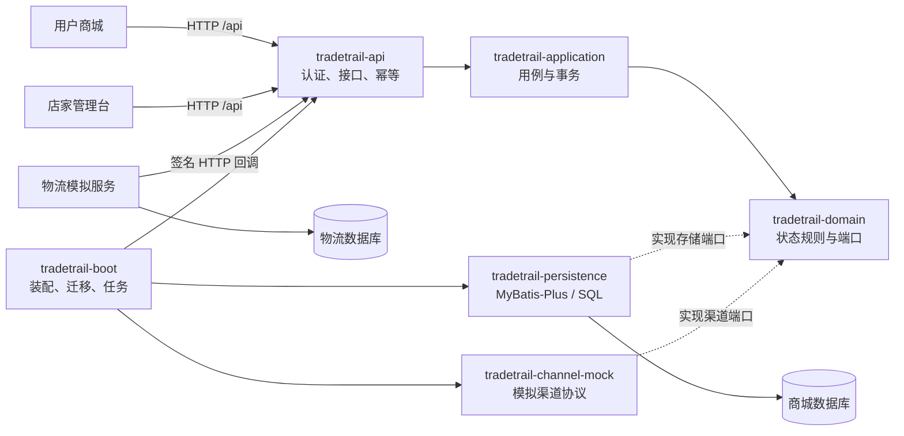
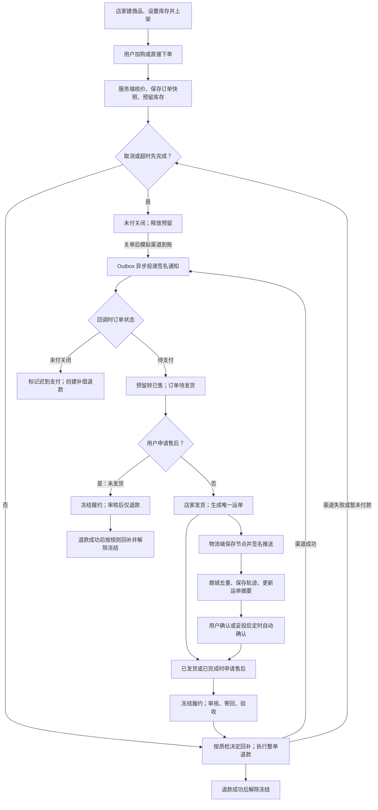
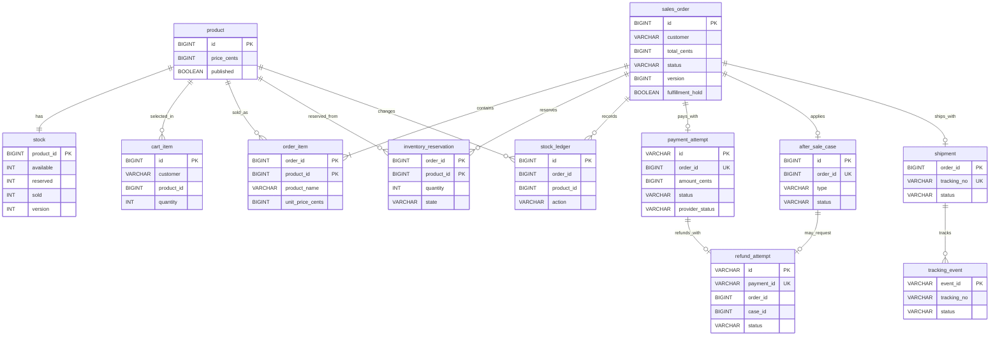
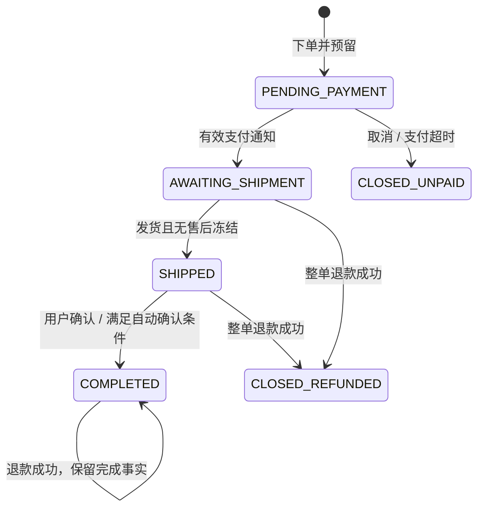
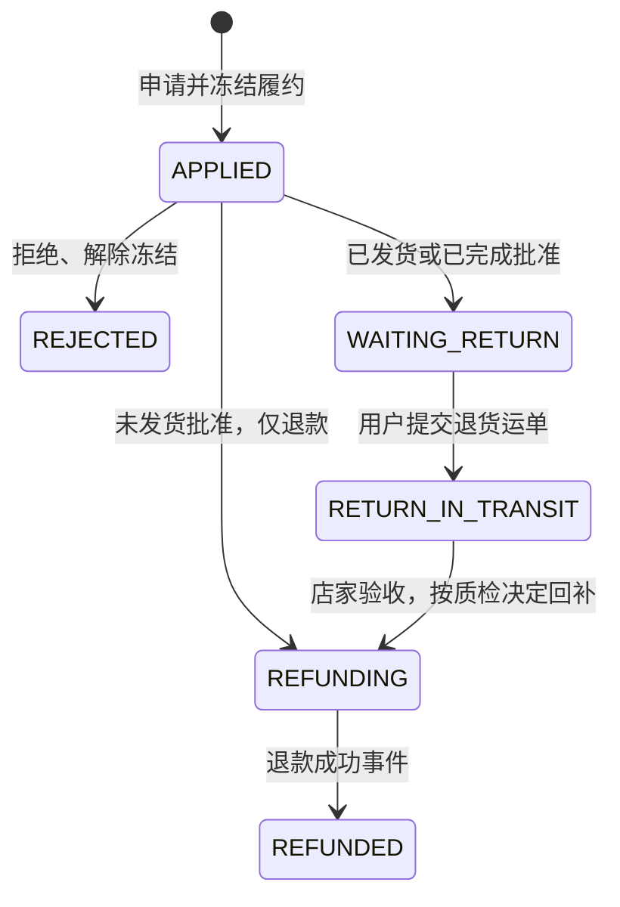
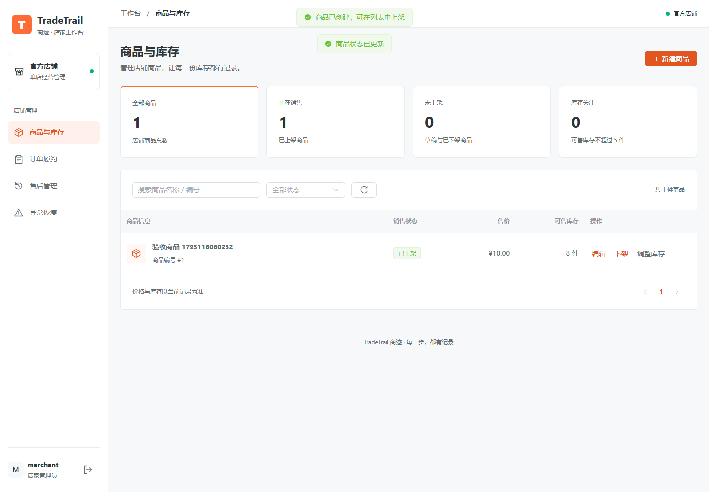
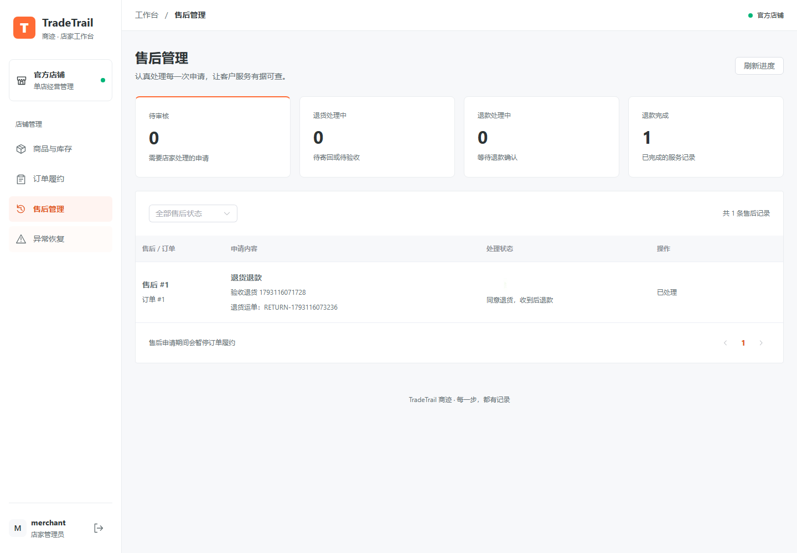
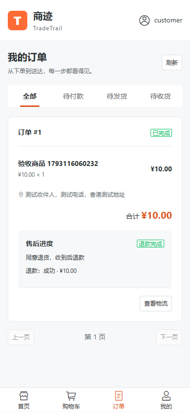

# TradeTrail（商迹）

TradeTrail 是一个面向单店场景的交易系统示例，覆盖商品、购物车、订单、库存、模拟支付、物流履约、售后与退款。项目由商城模块化单体、用户与店家两套 Vue 应用，以及独立的物流模拟服务组成。重点是交易状态与库存一致性、异步通知的幂等处理、失败后的可恢复性。

> 当前支付和退款均为 mock，不发生真实资金交易。业务范围为单店、单币种、单仓、单包裹、按商品购买、整单退款；没有独立的多规格 SKU、拆单或部分退款。实际完成度与待验收项以[项目方案](docs/Plan.md)为准。

## 目录

- [系统架构](#系统架构)
- [业务流程](#业务流程)
- [数据库关系](#数据库关系)
- [状态机与交易约束](#状态机与交易约束)
- [工程实现](#工程实现)
- [本地运行](#本地运行)
- [验证与文档](#验证与文档)

## 系统架构

| 入口 | 技术 | 职责 |
|---|---|---|
| 用户商城 | Vue 3、TypeScript、Vant、Pinia | 浏览、结算、支付、查询订单与物流、申请售后 |
| 店家管理台 | Vue 3、TypeScript、Element Plus、Pinia | 商品与库存、发货、售后审核、失败任务恢复 |
| 物流模拟端 | 独立 Spring Boot、Thymeleaf | 录入节点、持久化投递记录、签名推送与重试 |



商城 Maven 工程包含 7 个模块。`tradetrail-boot` 装配接口、应用、持久化和 mock 渠道；Controller 按角色与业务资源分组。物流服务只通过 HTTP 与商城交互，使用自己的数据库，不依赖商城领域 JAR。更细的依赖和数据写入边界见[业务分层设计](docs/design/02-业务分层设计图.md)。

| 层或模块 | 主要责任 |
|---|---|
| `tradetrail-api` | Session、CSRF、角色与资源归属、请求校验、幂等及错误合同 |
| `tradetrail-application` | 商品、购物车、订单、库存、支付、履约、售后及集成用例 |
| `tradetrail-domain` | 订单状态机、领域记录、仓储与渠道端口 |
| `tradetrail-persistence` | MyBatis-Plus Mapper、交易 SQL、持久化适配器 |
| `tradetrail-channel-mock` | 模拟支付与签名通知协议 |
| `tradetrail-boot` | 启动装配、Flyway、定时任务与集成测试 |

## 业务流程

下图概括交易主流程。支付通知和物流推送在本地事务提交后异步处理；前端提交“模拟付款成功”只登记渠道结果，订单在签名通知通过校验后才确认支付。



| 关键环节 | 服务端保证与失败路径 |
|---|---|
| 下单 | 按 `productId` 顺序核价和预留；任一商品失败，订单与先前预留一起回滚；订单保存名称、成交价和地址快照。 |
| 支付 | 渠道结果、outbox 事件和签名回调分开处理；重复通知去重；支付与关单竞争时锁定订单并重新判断。 |
| 履约 | 发货检查订单状态及售后冻结；物流事件按事件 ID 去重，迟到节点保留在时间线但不倒退摘要。 |
| 售后 | 申请即冻结履约；未发货走仅退款，已发货或已完成走退货退款；失败退款沿原退款号重试。 |
| 外部投递 | 业务事实与 outbox 同事务提交，外部 HTTP 可能重复，处理方依靠去重与状态守卫恢复。 |

## 数据库关系

下图是**业务逻辑关系图（ER/UML 视图）**，展示主要表和关联基数。当前 Flyway 迁移**未声明数据库外键**；图中的连线不是已落地的 FK 约束。唯一键、状态条件更新和应用事务承担实际一致性控制。完整字段以[商城迁移](tradetrail-boot/src/main/resources/db/migration)为准。



`order_item` 是当前多商品订单的明细与价格快照；`sales_order` 中的单商品字段保留历史兼容。`payment_attempt.order_id`、`refund_attempt.payment_id`、`after_sale_case.order_id` 和 `shipment.order_id` 的唯一约束分别限定为每单一笔支付尝试、每支付一笔整单退款、每单一张售后工单和一张发货单。

审计与集成表包括 `order_status_log`、`stock_adjustment`、`after_sale_action`、`payment_notice`、`idempotency_record`、`outbox_event` 和 `inbox_event`。物流库单独保存 `sim_tracking_event`，商城仅保存接收到的 `tracking_event`；两库之间没有跨库事务。表清单与接口映射见[模块设计](docs/design/03-模块设计图.md)，物流表结构见[物流迁移](tradetrail-logistics-simulator/src/main/resources/db/migration)。

## 状态机与交易约束

### 订单主状态



`fulfillment_hold` 是单独的售后冻结标记，阻止发货和确认；它不是订单主状态。物流妥投只为定时自动确认提供条件，不直接把订单改为 `COMPLETED`。已完成订单退款后仍为 `COMPLETED`，退款结果由售后和退款记录表达。状态转换守卫以 [OrderState](tradetrail-domain/src/main/java/com/tradetrail/domain/order/OrderState.java) 为准。

### 售后状态



`REFUNDING` 期间退款尝试可能是 `REQUESTED` 或 `FAILED`；失败后沿同一退款号重试。退货质检合格时先回补库存，仅退款在退款成功后回补。库存预留依次遵守 `RESERVED → CONFIRMED / RELEASED`，符合条件的售后回补为 `CONFIRMED → RESTOCKED`。更完整的事件、守卫和竞争分析见[订单与相关状态机](docs/design/01-订单状态机.md)。

## 工程实现

| 关注点 | 当前机制 |
|---|---|
| 数据一致性 | MySQL `READ COMMITTED`、订单行锁、预期状态和版本条件更新、库存条件更新及唯一流水。 |
| 请求幂等 | 写请求使用 `Idempotency-Key`；同一身份和键不能更换方法、路径或原始 JSON，成功响应可重放。 |
| 回调安全 | 支付与物流分别按 mock 协议验签；回调再核验金额、事件身份及当前业务状态。 |
| 异步恢复 | 商城 outbox/inbox、物流持久化投递和退避重试；失败退款与耗尽重试事件可由店家人工恢复。 |
| 自动化验证 | JUnit、MockMvc、Testcontainers MySQL、ArchUnit、Playwright 与 GitHub Actions。 |

技术栈为 Java 21、Spring Boot 3.5.16、MyBatis-Plus 3.5.17、Flyway、MySQL 8.4、H2、Vue 3、TypeScript 和 Vite。Compose 提供 MySQL 与可选 Redis；当前业务没有接入 Redis 或消息队列。列表查询仍有全量读取后分页的实现，生产容量、多实例与进程故障恢复尚需专项验收，详见[项目方案](docs/Plan.md)。

## 本地运行

环境要求：JDK 21、Maven 3.9、Node.js 22.12+。以下命令使用 PowerShell 7，在仓库根目录执行。默认 H2 文件库不需要 Docker；MySQL 模式需要 Docker Desktop。

```powershell
mvn clean package
npm ci --prefix frontend/customer --include=dev
npm ci --prefix frontend/merchant --include=dev
```

分别在两个终端从仓库根目录启动商城和物流服务：

```powershell
java -jar tradetrail-boot/target/tradetrail-boot-0.1.0-SNAPSHOT.jar
```

```powershell
java -jar tradetrail-logistics-simulator/target/tradetrail-logistics-simulator-0.1.0-SNAPSHOT.jar
```

再分别启动两套前端：

```powershell
npm --prefix frontend/customer run dev
npm --prefix frontend/merchant run dev
```

| 入口 | 本地地址 | 演示账号 |
|---|---|---|
| 用户商城 | `http://127.0.0.1:5173` | `customer / customer123` |
| 店家管理台 | `http://127.0.0.1:5174` | `merchant / merchant123` |
| 物流模拟端 | `http://localhost:8081` | `logistics / logistics123` |

新库没有预置商品，先用店家端创建商品、录入库存并上架。用户和店家使用不同浏览器配置文件，或分别使用普通与无痕窗口，以免同一主机上的会话 Cookie 相互覆盖。默认数据写入仓库 `data/` 下的两份独立 H2 文件库，重启会保留。演示账号和默认密钥仅供本地使用。

MySQL 开发模式先执行 `docker compose up -d mysql`，再给两个 Java 进程分别追加 `--spring.profiles.active=mysql`。Compose 只启动中间件，不启动 Java 服务或前端；切换 profile 不迁移 H2 数据。环境变量、端口联动及静态部署见[开发与部署参考](docs/development-and-deployment.md)。

## 验证与文档

```powershell
mvn test
mvn -Pmysql-it verify
npm --prefix frontend/customer run build
npm --prefix frontend/merchant run build
npm ci --prefix frontend
npm --prefix frontend run format:check
npm --prefix frontend run test:e2e
```

MySQL 集成测试需要 Docker；浏览器测试使用独立 H2 内存库，并需先安装 Chromium。具体准备步骤见[测试与调试](docs/testing.md)。[CI 配置](.github/workflows/verify.yml)执行后端、MySQL、格式、前端构建和浏览器验收。2026-10-27 的本机历史验收记录在[项目方案](docs/Plan.md)，不代表当前工作区已重新验收。

| 文档 | 内容 |
|---|---|
| [项目方案](docs/Plan.md) | 范围、实施状态、限制与历史验收 |
| [后端设计](docs/design/TradeTrail-后端设计文档.md) | 主调用链、事务与鉴权 |
| [业务分层](docs/design/02-业务分层设计图.md) / [模块设计](docs/design/03-模块设计图.md) | 模块边界、数据所有权、接口与表 |
| [订单与相关状态机](docs/design/01-订单状态机.md) | 状态转换、库存、竞争与补偿 |
| [测试与调试](docs/testing.md) / [开发与部署](docs/development-and-deployment.md) | 验收步骤、配置、运行与排错 |
| [Agent 规范](agent.md) / [AI 资源](ai-agent/README.md) | 仓库协作要求与项目工具 |

### 界面展示

本地 Chromium 验收截图：

| 店家商品与库存 | 店家售后管理 | 用户移动端售后结果 |
|---|---|---|
|  |  |  |
