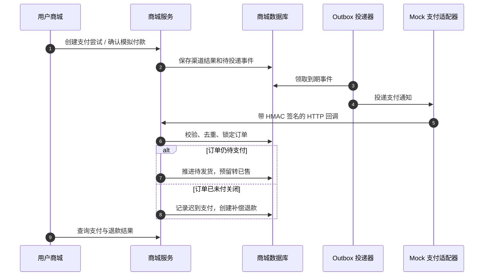
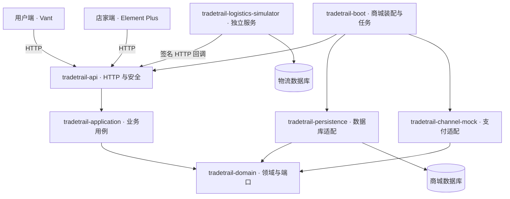
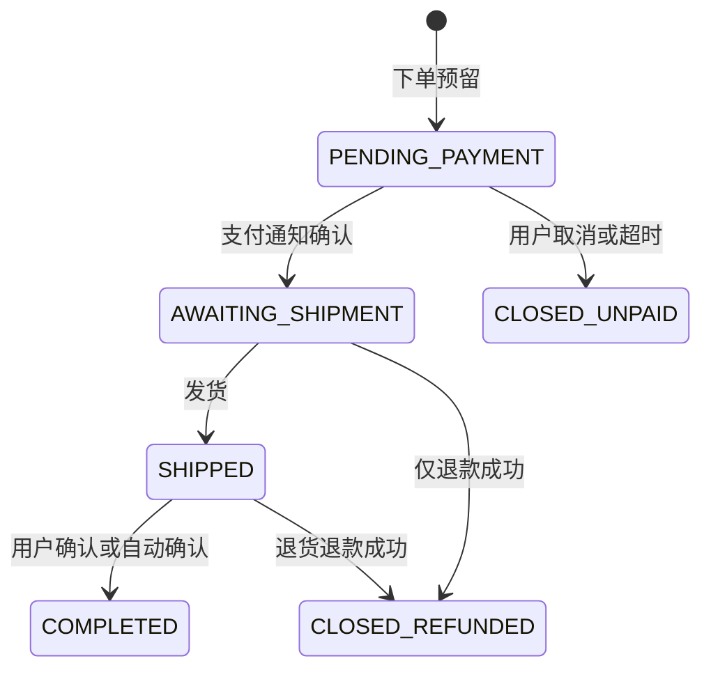
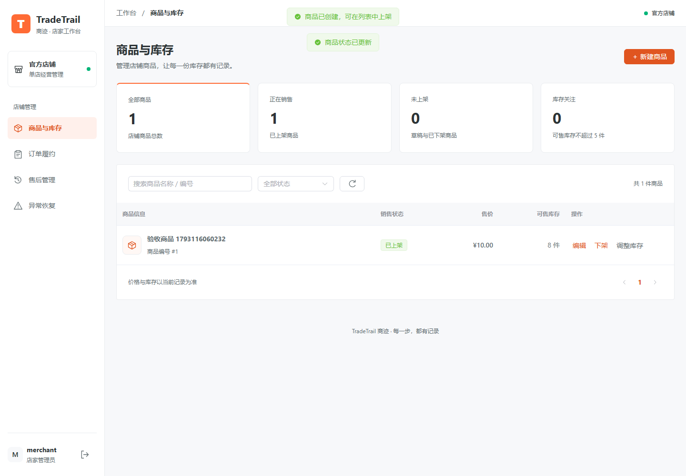
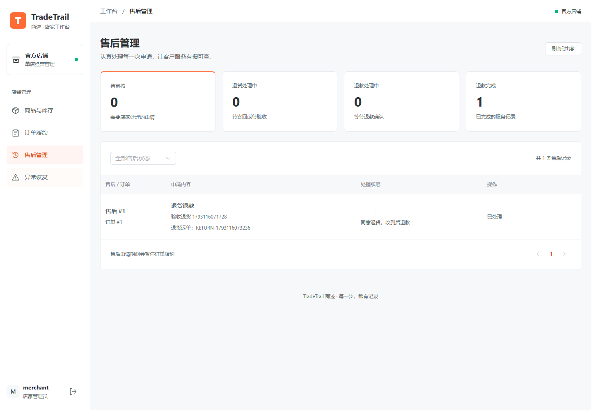
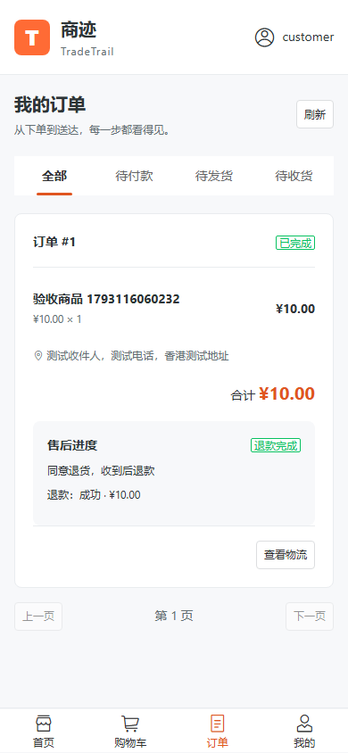

<h1 align="center">📦 TradeTrail 商迹商城</h1>

<p align="center">
  <strong>单店交易闭环 · 订单与库存一致性 · 异步模拟支付 · 独立物流推送 · 售后退款与失败恢复</strong>
</p>

<p align="center">
  
  
  
  
  
  
  
  <a href="https://github.com/kamten7/TradeTrail/actions/workflows/verify.yml"></a>
</p>

<p align="center">
  <a href="#-核心亮点">核心亮点</a> ·
  <a href="#-系统架构">系统架构</a> ·
  <a href="#-功能清单">功能清单</a> ·
  <a href="#-快速开始">快速开始</a> ·
  <a href="#-接口一览">接口一览</a> ·
  <a href="#-实机展示">实机展示</a>
</p>

---

## 📖 项目介绍

**TradeTrail（商迹）** 是一个基于 **Spring Boot 多模块 + Vue 3 双前端** 的单店商城项目，围绕「**商品上架 → 购物车结算 → 下单预留 → 模拟支付 → 发货与物流 → 确认收货 → 售后退款**」实现交易流程。

项目在一个仓库中维护三个操作入口：

| 入口 | 实现 | 主要职责 |
|---|---|---|
| 用户商城 | Vue 3 + TypeScript + Vant + Pinia | 浏览加购、结算付款、订单物流、收货与售后 |
| 店家管理台 | Vue 3 + TypeScript + Element Plus + Pinia | 商品库存、订单发货、售后审核、失败任务恢复 |
| 物流模拟端 | 独立 Spring Boot 服务 + Thymeleaf | 录入轨迹、持久化投递记录、签名推送与重试 |

商城采用**模块化单体**，把业务域和基础设施分开；物流服务使用自己的数据库，只通过 HTTP 向商城推送事件。支付和退款使用 **mock 渠道**，用于验证状态、库存、回调和恢复，不发生真实资金交易。

当前业务范围为**单店、单币种、单仓、单包裹、整单退款**，重点在于交易规则和异常路径的可验证实现。

---

## ✨ 核心亮点

### 1. 订单状态机与库存预留共同约束交易

下单、付款、取消、退款分别对应明确的库存转换，而不是只修改一个订单状态字段。

| 动作 | 库存变化 | 业务约束 |
|---|---|---|
| 下单 | 可售 → 预留 | 服务端核价，多商品按固定顺序处理，库存不足整体回滚 |
| 支付确认 | 预留 → 已售 | 验证渠道记录与金额，重复通知不重复确认 |
| 未付关闭 | 预留 → 可售 | 取消、超时处理共用订单锁，已收到支付不能直接释放 |
| 售后回补 | 已售 → 可售 | 未发货退款成功或退货质检合格后回补，保留唯一业务流水 |

订单保存**商品名称、成交单价、数量和收货地址快照**；后续改价、下架不修改历史订单。状态转换写入版本和审计日志，售后冻结作为独立标记参与履约守卫。

> 关键代码：[OrderState](tradetrail-domain/src/main/java/com/tradetrail/domain/order/OrderState.java)、[OrderService](tradetrail-application/src/main/java/com/tradetrail/application/order/OrderService.java)、[InventoryService](tradetrail-application/src/main/java/com/tradetrail/application/inventory/InventoryService.java)

### 2. 异步支付通知与迟到支付补偿

模拟收银台登记渠道结果后，由 outbox 驱动 **签名 HTTP 通知**，订单在通知验证通过后再推进。支付尝试、渠道结果、通知和退款分别留有记录。



- **稳定请求号**：相同成功写请求可重放；网络中断后前端保留原幂等键，避免响应丢失导致重复下单。
- **关单竞争保护**：支付、取消和超时使用同一订单锁序列化；关单后到账不重新占库存，走补偿退款。
- **可复现失败**：配置首次 mock 退款失败，店家能查看原因并沿用原退款号重试。

> 关键代码：[PaymentService](tradetrail-application/src/main/java/com/tradetrail/application/payment/PaymentService.java)、[MockPaymentGateway](tradetrail-channel-mock/src/main/java/com/tradetrail/channel/mock/MockPaymentGateway.java)、[IdempotencyFilter](tradetrail-api/src/main/java/com/tradetrail/api/IdempotencyFilter.java)

### 3. 售后与履约联动，退款与实物回补分别判断

- **申请即冻结履约**：受理售后后，订单暂停发货和确认收货；审核拒绝则释放冻结。
- **按履约阶段分流**：未发货走整单仅退款；已发货或已完成走退货退款。
- **验收决定回补**：退货质检合格才回补可售库存；“不回补库存”仍可继续退款。
- **保留完成事实**：已完成订单退款后仍保持完成状态，售后与退款进度独立展示。

合格商品回库后，即使退款暂时失败，库存也不会因重新提交退款而重复增加。当前每单只允许一个售后工单。

> 关键代码：[AfterSaleService](tradetrail-application/src/main/java/com/tradetrail/application/after_sale/AfterSaleService.java)、[FulfillmentService](tradetrail-application/src/main/java/com/tradetrail/application/fulfillment/FulfillmentService.java)

### 4. 独立物流服务与可恢复事件投递

物流操作者在独立服务输入运单和节点。事件先写物流数据库，再通过 HMAC-SHA256 签名 HTTP 回调推送商城，浏览器不持有服务间密钥。

- **事件去重**：重复通知不会重复插入轨迹或改变库存。
- **摘要防倒退**：迟到轨迹保留在时间线，当前摘要不回退；妥投后不因旧节点重新变成运输中。
- **异常可恢复**：`EXCEPTION → RESUMED` 保留已有派送进度。
- **失败可重试**：网络或服务端错误按退避重试；4xx 拒绝留给人工核对，耗尽重试后可手动恢复。

商城 outbox 同样使用持久化租约与失败队列，消费者保存 inbox 去重记录。定时任务可重新进入，执行前重新检查业务条件。

> 关键代码：[DeliveryService](tradetrail-logistics-simulator/src/main/java/com/tradetrail/simulator/DeliveryService.java)、[OutboxDispatcher](tradetrail-application/src/main/java/com/tradetrail/application/integration/OutboxDispatcher.java)、[TradeJobs](tradetrail-boot/src/main/java/com/tradetrail/TradeJobs.java)

---

## 🧱 系统架构

### 模块与依赖



Controller 按**角色 + 业务资源**组织，应用层协调事务，领域层不依赖 Spring 或 ORM；持久层和渠道适配器实现领域端口。物流服务不依赖商城领域 JAR，也不访问商城表。

### 技术栈

| 类别 | 技术 | 项目用途 |
|---|---|---|
| 核心框架 | Java 21 · Spring Boot 3.5.16 | REST 服务、依赖装配、事务与定时任务 |
| 持久化 | MyBatis-Plus 3.5.17 | 单表 CRUD、行锁与关键条件更新 SQL |
| 数据库 | MySQL 8.4 · H2 · Flyway | 开发持久化、轻量启动、版本化迁移 |
| 安全 | Spring Security · Session · CSRF | 角色、归属与写请求防护 |
| 前端 | Vue 3 · TypeScript · Vite · Pinia | 用户与店家独立应用，共享请求和类型 |
| 组件库 | Vant 4 · Element Plus 2 | 移动商城与店家工作台 |
| 外部交互 | RestClient · HMAC-SHA256 | 支付通知、独立物流推送 |
| 质量验证 | JUnit 5 · MockMvc · Testcontainers · ArchUnit · Playwright | 接口、并发、架构与浏览器验收 |

Docker Compose 还提供可选 Redis 开发服务，当前业务未接入 Redis，也未引入消息队列；库存和订单事实存储在数据库中。

---

## 💡 功能清单

### 店家管理台

| 模块 | 能力 |
|---|---|
| 商品与库存 | 新建、编辑、上下架、改价、库存调整及原因记录 |
| 订单履约 | 状态与客户筛选、订单明细、地址快照、发货与运单查看 |
| 售后管理 | 申请审核、审核理由、退货验收、质检是否回补 |
| 异常恢复 | 查询失败退款、同号重试、耗尽自动重试任务的人工恢复 |

### 用户商城

| 模块 | 能力 |
|---|---|
| 商品 | 浏览、页面搜索、售价与可售库存查看、加购 |
| 购物车 | 数量修改、选中、移除、结算报价、收货信息 |
| 订单 | 下单、取消、模拟付款、状态查询、确认收货 |
| 物流 | 运单与本地轨迹时间线查看 |
| 售后 | 申请售后、查看审核与退款结果、填写退货运单 |

### 物流模拟端

运单节点录入 · 独立事件存储 · 签名推送 · 投递结果与失败原因 · 自动退避重试 · 人工重试。

---

## 🔄 核心业务流程

1. **商品准备**：店家创建商品、录入库存并上架。
2. **购物车结算**：用户选择商品与数量、填写地址，服务端重新核价并预留库存。
3. **支付确认**：用户确认模拟付款，签名通知验证后推进待发货。
4. **订单履约**：店家检查售后冻结后发货，生成唯一 `MOCK-...` 运单。
5. **物流推送**：物流端录入节点，商城保存轨迹并更新摘要。
6. **确认收货**：用户主动确认，或妥投后满足定时规则自动完成。
7. **售后处理**：审核后按仅退款或退货退款处理，记录验收、回补和退款结果。



> 状态：`PENDING_PAYMENT 待支付` · `AWAITING_SHIPMENT 待发货` · `SHIPPED 已发货` · `COMPLETED 已完成` · `CLOSED_UNPAID 未付关闭` · `CLOSED_REFUNDED 退款关闭`。售后冻结和物流状态独立记录；已完成订单退款后不改变主状态。

---

## 📁 目录结构

```text
TradeTrail/
├── tradetrail-domain/                # 领域对象、状态机与仓储端口
├── tradetrail-application/           # 商品、购物车、订单、库存、支付、履约、售后用例
├── tradetrail-persistence/           # MyBatis-Plus、交易 SQL 与仓储实现
├── tradetrail-api/                   # 按角色和资源分组的接口、安全及幂等处理
├── tradetrail-channel-mock/          # 模拟支付适配器和通知签名协议
├── tradetrail-boot/                  # 商城启动、Flyway 迁移、任务与集成测试
├── tradetrail-logistics-simulator/   # 独立物流服务、操作页、迁移与投递恢复
├── frontend/
│   ├── customer/                    # Vant 用户商城
│   ├── merchant/                    # Element Plus 店家管理台
│   ├── shared/                      # 请求、幂等重试和业务类型
│   └── tests/                       # Playwright 浏览器验收
├── docs/                            # 设计、调试、验收记录与实机截图
├── ai-agent/tools/smoke.ps1          # 商城到独立物流的 HTTP 冒烟脚本
├── docker/mysql/init/               # 物流数据库初始化脚本
├── compose.yaml                     # MySQL 与可选 Redis 开发服务
└── Plan.md                          # 项目设计目标
```

---

## 🚀 快速开始

### 环境要求

JDK **21**、Maven **3.9**、建议 Node.js **22.12+**。以下命令采用 **PowerShell 7**；使用 MySQL 或 Testcontainers 时需先启动 Docker Desktop。

### 1. 获取代码与安装依赖

```powershell
git clone https://github.com/kamten7/TradeTrail.git
Set-Location TradeTrail
mvn clean package
npm ci --prefix frontend/customer
npm ci --prefix frontend/merchant
```

### 2. 启动后端

**方式 A：H2 轻量体验**，不需要 Docker，分别在仓库根目录的两个终端执行：

```powershell
java -jar tradetrail-boot/target/tradetrail-boot-0.1.0-SNAPSHOT.jar --spring.profiles.active=default
```

```powershell
java -jar tradetrail-logistics-simulator/target/tradetrail-logistics-simulator-0.1.0-SNAPSHOT.jar --spring.profiles.active=default
```

默认在 `data/` 保存两份 H2 文件库，重启保留数据。工作目录保持为仓库根；终端若有 `SPRING_DATASOURCE_*` 覆盖变量，需核对实际连接目标。

**方式 B：MySQL 开发环境**，先启动数据库并等待 `healthy`：

```powershell
docker compose up -d mysql
docker compose ps
```

随后将两个服务启动参数中的 `--spring.profiles.active=default` 改为 `--spring.profiles.active=mysql`。MySQL 主机端口为 `3310`，商城库 `tradetrail`，物流库 `tradetrail_logistics`，本地数据库账号为 `tradetrail / tradetrail`。H2 与 MySQL 的数据不自动迁移。

### 3. 启动页面

两个新终端分别执行：

```powershell
npm --prefix frontend/customer run dev
```

```powershell
npm --prefix frontend/merchant run dev
```

| 入口 | 地址 | 本地演示账号 |
|---|---|---|
| 用户商城 | http://127.0.0.1:5173 | `customer / customer123` |
| 店家管理台 | http://127.0.0.1:5174 | `merchant / merchant123` |
| 物流模拟端 | http://localhost:8081 | `logistics / logistics123` |

用户和店家请使用**不同浏览器配置文件，或普通窗口与无痕窗口**，Cookie 不按端口隔离。新库没有预置商品，先在店家端创建并上架。需要独立数据、逐项断言及故障演练时，从[手工验收文档](docs/testing/manual-acceptance.md)开始。

---

## ⚙️ 配置与数据库

| 文件或参数 | 作用 |
|---|---|
| [商城 application.yml](tradetrail-boot/src/main/resources/application.yml) | 8080 端口、默认 H2、UTC、事务隔离与 MyBatis 配置 |
| [商城 application-mysql.yml](tradetrail-boot/src/main/resources/application-mysql.yml) | 商城 MySQL URL、账号与连接时区 |
| [物流 application.yml](tradetrail-logistics-simulator/src/main/resources/application.yml) | 8081 端口、独立 H2 与商城推送地址 |
| [物流 application-mysql.yml](tradetrail-logistics-simulator/src/main/resources/application-mysql.yml) | 独立物流 MySQL 配置 |
| `TRADETRAIL_API_TARGET` | 两个前端的商城代理目标，默认 `http://127.0.0.1:8080` |
| `tradetrail.payment.callback-url` | mock 支付通知目标，默认 `http://127.0.0.1:8080` |
| `TRADETRAIL_MALL_URL` | 物流推送目标，默认 `http://localhost:8080` |
| `TRADETRAIL_LOGISTICS_SECRET` | 两服务共享的物流签名密钥 |

业务表由[商城 Flyway 迁移](tradetrail-boot/src/main/resources/db/migration)和[物流 Flyway 迁移](tradetrail-logistics-simulator/src/main/resources/db/migration)分别管理。Docker 的[初始化脚本](docker/mysql/init/01-logistics.sql)负责首次建立物流数据库和授权；已有数据卷不会自动重跑脚本。

Compose 当前只启动中间件，两套前端与两个后端仍需单独运行。完整环境变量、端口联动、静态部署和 Nginx 示例收录在[开发与部署参考](docs/development-and-deployment.md)。

---

## 🔌 接口一览

浏览器通过 `/api` 代理访问商城，直接调用后端时不带 `/api`。认证采用 **Session + CSRF**，业务写请求另带 `Idempotency-Key`；支付和物流回调使用各自的签名协议。

| 调用方 | 核心接口 | 方法 | 用途 |
|---|---|---|---|
| 会话 | `/session`、`/login` | GET / POST | 获取身份和 CSRF、表单登录 |
| 用户 | `/products`、`/products/{id}` | GET | 商品列表与详情 |
| 用户 | `/cart/items`、`/cart/items/{id}` | GET / POST；PUT / DELETE | 购物车查询、加购、修改与移除 |
| 用户 | `/cart/checkout`、`/orders` | POST | 购物车结算或直接下单 |
| 用户 | `/orders/{id}/payments` | GET / POST | 查询支付结果或创建支付尝试 |
| 用户 | `/mock/checkout/{id}/complete` | POST | 模拟收银台提交结果 |
| 用户 | `/orders/{id}/cancel`、`/orders/{id}/confirm` | POST | 取消或确认收货 |
| 用户 | `/orders/{id}/tracking`、`/orders/{id}/history` | GET | 物流轨迹、订单状态记录 |
| 用户 | `/orders/{id}/after-sales`、`/after-sales/{id}/return` | POST | 售后申请、提交退货运单 |
| 店家 | `/admin/products`、`/admin/products/{id}` | GET / POST；PUT | 商品查询、创建与维护 |
| 店家 | `/admin/orders/{id}/shipments` | POST | 订单发货 |
| 店家 | `/admin/after-sales/{id}/decisions` | POST | 审核售后申请 |
| 店家 | `/admin/after-sales/{id}/receipts` | POST | 退货验收与质检回补 |
| 店家 | `/admin/refunds/failed`、`/admin/refunds/{id}/retry` | GET / POST | 查询失败退款、原号重试 |
| 店家 | `/admin/outbox`、`/admin/outbox/{id}/retry` | GET / POST | 失败任务查询与恢复 |
| 回调 | `/callbacks/payments/mock`、`/callbacks/logistics/mock` | POST | 支付与物流签名通知 |

金额字段使用**整数分**。可复制请求、统一错误响应、权限与幂等验证见[接口调试指南](docs/testing/debugging.md)。

---

## 📸 实机展示

以下为本地 Chromium 验收截图，使用测试账号与演示数据；物流模拟服务仍通过独立页面操作。

### 店家管理台

**商品与库存** — 商品状态、可售库存、改价、上下架与库存调整。

<p align="center">
  
</p>

**售后管理** — 审核结果、退货运单、验收和退款进度。

<p align="center">
  
</p>

### 用户商城

**订单与售后结果** — 完成订单的退款结果独立显示，保留订单履约完成状态。

<p align="center">
  
</p>

---

## 🧪 工程质量

| 项目 | 当前实现与验证方式 |
|---|---|
| 接口与领域回归 | 入参、权限、归属、状态机、库存和幂等测试 |
| 真实数据库回归 | Testcontainers MySQL 8.4，验证并发、事务回滚与重复通知 |
| 架构约束 | ArchUnit 检查领域层依赖、持久层隔离与仓储归属 |
| 浏览器验收 | Playwright 自动启动独立内存库和双前端，验证交易、响应丢失、退款失败恢复及窄屏 |
| 两服务冒烟 | PowerShell 脚本验证商品到独立物流签名推送的 HTTP 链路 |
| 持续集成 | [GitHub Actions Verify](.github/workflows/verify.yml)：后端、MySQL、格式、构建、Chromium 与报告归档 |
| 故障演练 | 可配置首次退款失败、加速关单和自动确认，页面支持人工恢复 |

已记录的 2026-10-27 本机验收结果：**69 项普通后端与物流测试、13 项 MySQL 集成测试、3 项浏览器场景通过**。这是历史验证记录，当前提交的 CI 结果以页首徽章和 Actions 报告为准。100 买家抢 10 件的用例验证无超卖，不作为容量压测结论。

```powershell
# 后端与真实 MySQL（后者需要 Docker）
mvn test
mvn -Pmysql-it verify

# 两端类型检查与生产构建
npm --prefix frontend/customer run build
npm --prefix frontend/merchant run build

# 浏览器验收：先完成 Maven 打包和前端依赖安装
npm ci --prefix frontend
Push-Location frontend
npx playwright install chromium
npm run format:check
npm run test:e2e
Pop-Location
```

Playwright 使用 `18080 / 15173 / 15174`，须保证端口空闲并清除遗留 `MERCHANT_URL`、`CUSTOMER_URL` 覆盖变量。两后端手工运行时执行 `./ai-agent/tools/smoke.ps1`，会向连接的库写入演示数据。

---

## 🗺️ 路线图与实现边界

- [x] 用户、店家与独立物流三端交易主流程
- [x] 商品与订单快照、库存预留、状态机及审计
- [x] 异步模拟支付、超时关闭、迟到支付补偿
- [x] 售后冻结、审核、退货验收与整单退款
- [x] outbox/inbox、物流恢复、失败退款人工重试
- [x] MySQL 并发回归、架构检查、浏览器验收与 CI 配置
- [ ] 容量压测、多实例与进程故障专项验证
- [ ] 退货寄回超时自动终止、物流异常独立工单
- [ ] 大数据量列表查询与数据库分页完善
- [ ] 真实支付/退款渠道及渠道结果查询

演示账号和默认密钥用于本地体验；当前没有完整账号管理或生产身份体系。完整目标与差距见 [Plan.md](Plan.md) 和[交付检查](docs/delivery-checklist.md)。

## 📚 项目文档

| 文档 | 内容 |
|---|---|
| [手工验收与故障演练](docs/testing/manual-acceptance.md) | 独立环境、14 个用例、库存断言和记录模板 |
| [接口、断点与排错](docs/testing/debugging.md) | 可执行请求、幂等与补偿验证、IDE 断点、SQL |
| [开发与部署参考](docs/development-and-deployment.md) | 配置参数、接口约定、开发流程、Nginx 示例与维护 |
| [业务流程与接口说明](docs/implementation-roadmap.md) | 已实现的调用链、状态和接口变更 |
| [交付检查](docs/delivery-checklist.md) | 验收证据及未完成项 |
| [后端设计](docs/design/TradeTrail-后端设计文档.md) / [订单状态机](docs/design/01-订单状态机.md) | 设计方案与规则 |
| [业务分层](docs/design/02-业务分层设计图.md) / [模块设计](docs/design/03-模块设计图.md) | 模块边界与协作关系 |
| [开发规范](agent.md) | 编码、接口组织和上下游检查要求 |
