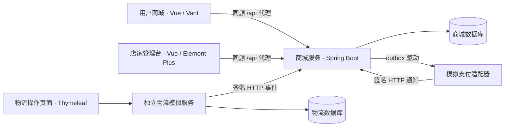
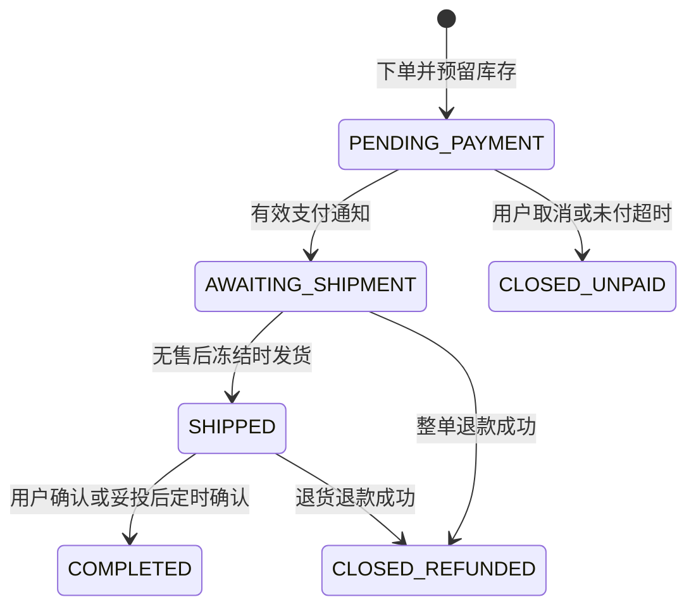

# TradeTrail · 商迹

**基于模块化单体的单店交易与履约演示系统。**

TradeTrail 将商品、购物车、订单、库存、支付、物流和售后串成可调试的交易流程。项目包含用户商城、店家管理台，以及独立运行、通过签名 HTTP 回调推送轨迹的物流模拟服务。

当前定位为课程演示与工程实践：支付和退款使用模拟渠道，订单、库存、交易记录及失败恢复使用真实持久化逻辑。已实现范围与未完成项分别记录，不将设计目标等同于生产就绪能力。

[快速启动](#快速启动) · [配置参考](#配置参考) · [测试与质量检查](#测试与质量检查) · [手工验收](docs/testing/manual-acceptance.md) · [接口与断点调试](docs/testing/debugging.md)

## 阅读指引

| 你的目标 | 建议路径 |
|---|---|
| 第一次运行项目 | 环境要求 → 快速启动 → 跑通第一笔交易 |
| 自己测试页面 | [手工验收](docs/testing/manual-acceptance.md)，包含独立测试环境和 14 个用例 |
| 理解交易实现 | 系统结构 → 交易规则与数据一致性 → [业务与接口说明](docs/implementation-roadmap.md) |
| 修改代码并回归 | 本地开发约定 → 测试与质量检查 → [开发规范](agent.md) |
| 定位异常 | 常见问题 → [接口、断点与排错指南](docs/testing/debugging.md) |
| 了解实现程度 | 当前边界 → [交付检查](docs/delivery-checklist.md)，设计目标见 [Plan.md](Plan.md) |

## 核心能力

| 业务域 | 当前能力 |
|---|---|
| 商品与库存 | 商品创建、改价、上下架、库存调整及流水；历史订单保留成交快照 |
| 购物车与结算 | 选中结算、地址快照、服务端核价、库存预留、稳定请求号重试 |
| 订单 | 集中状态机、版本与状态审计、主动取消、超时关闭、确认收货 |
| 支付与退款 | 独立支付尝试、异步签名通知、迟到支付补偿、整单退款、失败后同号重试 |
| 履约与物流 | 售后阻断发货、独立运单、轨迹去重、摘要防倒退、异常恢复 |
| 售后 | 审核通过或拒绝、仅退款、退货运单、验收与合格库存回补 |
| 可靠性与验证 | outbox/inbox、租约恢复、人工重试、隔离测试库、MySQL 并发回归、浏览器验收 |

范围限定为**单店、单币种、单仓、单包裹、整单退款**。商品表单与接口金额单位均为分，页面展示为元。

## 系统结构



商城按业务域划分模块，物流模拟服务不访问商城数据库。订单与库存事实以数据库为准；Redis 仅作为可选开发服务，当前不参与业务处理。

| 目录 | 职责 |
|---|---|
| `tradetrail-domain` | 领域对象、订单状态机与仓储端口 |
| `tradetrail-application` | 业务用例、事务协调、事件与恢复 |
| `tradetrail-persistence` | MyBatis-Plus 与交易 SQL 实现 |
| `tradetrail-api` | 角色化 HTTP 接口、会话、鉴权、CSRF、幂等与错误合同 |
| `tradetrail-channel-mock` | 模拟支付通知协议与适配器 |
| `tradetrail-boot` | 商城启动、定时任务、配置、迁移与集成测试 |
| `tradetrail-logistics-simulator` | 独立物流录入、事件持久化与推送 |
| `frontend/customer` / `frontend/merchant` | 用户商城 / 店家管理台 |
| `frontend/shared` / `frontend/tests` | 共享请求与模型 / Playwright 验收 |
| `docs` / `ai-agent/tools` | 设计和调试文档 / 辅助脚本 |

商城依赖方向为 `API → Application → Domain`；持久层和渠道适配器实现外部交互，启动模块负责装配。业务域包括 `catalog`、`cart`、`order`、`inventory`、`payment`、`fulfillment`、`after_sale`，事件投递与恢复位于 `integration`。各域通过应用接口协调，架构测试检查框架依赖、持久层访问和仓储归属。

### 技术选择

| 层次 | 技术 | 在本项目中的用途 |
|---|---|---|
| Web 与安全 | Spring MVC、Spring Security | REST、角色与资源归属校验、会话和 CSRF |
| 业务协调 | Spring 事务、领域状态机 | 订单与库存原子更新、动作守卫及审计 |
| 持久化 | MyBatis-Plus、显式 Mapper SQL | 通用 CRUD、行锁、条件更新、唯一约束 |
| 数据库与迁移 | MySQL 8.4、H2、Flyway | 开发持久化、隔离测试、版本化表结构 |
| 事件恢复 | 数据库 outbox/inbox、定时任务 | 可重试投递、租约恢复、消费去重 |
| 页面 | Vue 3、TypeScript、Pinia、Vant / Element Plus | 独立用户端与店家端、共享请求合同 |
| 外部模拟 | 独立 Spring Boot + Thymeleaf 物流服务、mock 支付适配器 | 物流 HTTP 边界及异步支付通知 |
| 验证 | JUnit 5、MockMvc、Testcontainers、ArchUnit、Playwright | 接口、事务与并发、架构和真实浏览器回归 |

## 交易规则与数据一致性

### 订单主流程



`fulfillment_hold` 独立记录售后冻结，阻止发货和确认收货。物流的 `DELIVERED` 只更新物流事实，主订单仍等待确认；已完成订单售后退款成功后保留 `COMPLETED`，退款结果单独展示。关单后的迟到支付登记为 `LATE_PAYMENT` 并发起补偿退款，订单保持关闭。

### 关键约束

| 约束 | 实现行为 |
|---|---|
| 报价以服务端为准 | 结算重新验证价格、上架状态和库存；保存商品名、单价、数量与收货地址快照 |
| 库存状态可追踪 | 下单 `available → reserved`；付款 `reserved → sold`；未付关闭 `reserved → available` |
| 回补与实物一致 | 未发货退款成功后回补；已发货退货在质检合格时回补，不合格不回补 |
| 竞争操作序列化 | 支付、关单、发货和售后使用订单行锁；多商品下单按商品 ID 固定顺序处理 |
| 成功请求可安全重放 | 业务写请求使用稳定 `Idempotency-Key`；相同键异参拒绝，前端在网络失败后保留原键 |
| 通知不能重复记账 | 支付与物流通知验签并按事件 ID 去重，重复投递不重复推进订单或库存 |
| 投递与业务分开恢复 | 状态与 outbox 同事务保存；投递失败保留重试信息，耗尽重试后由店家人工恢复 |

默认商城连接采用 READ COMMITTED，MyBatis 本地缓存范围为 STATEMENT，避免在等待锁后继续读取旧快照。时间存储及无时区物流报文统一按 UTC 解释，用户端转换为本地时间。

### 数据记录与排查入口

| 记录 | 主要表 |
|---|---|
| 商品与库存 | `product`、`stock`、`stock_adjustment`、`stock_ledger` |
| 订单与快照 | `sales_order`、`order_item`、`inventory_reservation`、`order_status_log` |
| 支付与退款 | `payment_attempt`、`payment_notice`、`refund_attempt` |
| 售后与操作审计 | `after_sale_case`、`after_sale_action` |
| 运单与轨迹 | `shipment`、`tracking_event` |
| 幂等与消息恢复 | `idempotency_record`、`outbox_event`、`inbox_event` |
| 物流服务独立存储 | `sim_tracking_event`，位于物流库 |

表结构以[商城迁移](tradetrail-boot/src/main/resources/db/migration)和[物流迁移](tradetrail-logistics-simulator/src/main/resources/db/migration)为准。按订单追踪支付、退款、状态日志及 outbox 的只读查询见[数据库核对指南](docs/testing/debugging.md)。

## 环境要求

| 工具 | 要求与用途 |
|---|---|
| JDK | 21 |
| Maven | 3.9 系列 |
| Node.js | 建议 22.12+，用于两端构建和浏览器验收 |
| PowerShell | 本文命令按 PowerShell 7 编写；冒烟脚本使用 7 的 HTTP 参数 |
| Docker Desktop | MySQL 开发和 Testcontainers 集成测试需要；H2 启动不需要 |

后端采用 Spring Boot 3.5、MyBatis-Plus、Flyway；前端采用 Vue 3、TypeScript、Vite、Pinia。依赖版本以各模块构建文件与 lockfile 为准。

## 快速启动

以下终端均从仓库根目录开始。首次运行建议使用 H2；需要一套与既有开发数据分离的测试环境时，直接按[手工验收文档](docs/testing/manual-acceptance.md)启动。

### 1. 安装依赖并打包

```powershell
git clone https://github.com/kamten7/TradeTrail.git
Set-Location TradeTrail
mvn clean package
npm ci --prefix frontend/customer
npm ci --prefix frontend/merchant
```

已经克隆项目时，直接进入仓库根目录，省略 `git clone`。打包前先停止本项目正在运行的旧 JAR，避免 Windows 文件占用；不要在 JAR 运行时执行 `clean`。

### 2. 启动商城与物流服务

终端 A：

```powershell
java -jar tradetrail-boot/target/tradetrail-boot-0.1.0-SNAPSHOT.jar --spring.profiles.active=default
```

终端 B：

```powershell
java -jar tradetrail-logistics-simulator/target/tradetrail-logistics-simulator-0.1.0-SNAPSHOT.jar --spring.profiles.active=default
```

默认配置使用 `data/` 下的 H2 文件数据库，重启保留数据。若终端设置过 `SPRING_DATASOURCE_*` 等自定义参数，应先检查是否覆盖默认配置。两个服务出现 `Started ...Application` 后再启动前端。

### 3. 启动两端页面

终端 C：

```powershell
npm --prefix frontend/customer run dev
```

终端 D：

```powershell
npm --prefix frontend/merchant run dev
```

| 入口 | 地址 | 本地演示账号 |
|---|---|---|
| 用户商城 | http://127.0.0.1:5173 | `customer / customer123` |
| 店家管理台 | http://127.0.0.1:5174 | `merchant / merchant123` |
| 物流模拟端 | http://localhost:8081 | `logistics / logistics123` |
| 商城会话检查 | http://127.0.0.1:8080/session | 匿名也可返回 JSON |

**用户、店家使用不同浏览器配置文件，或普通窗口与无痕窗口。** Cookie 不按端口隔离，两个普通标签页无法保持独立角色会话。物流端使用 `localhost`，商城两端使用 `127.0.0.1`，减少同名会话 Cookie 冲突。

前端仅代理 `/api`，后端实际路径不带此前缀。修改商城端口时，需同时修改前端 `TRADETRAIL_API_TARGET`、支付 `tradetrail.payment.callback-url` 和物流 `tradetrail.mall-url`，详见[调试配置](docs/testing/debugging.md)。

### 4. 跑通第一笔交易

店家创建并上架商品 → 用户加购、填写地址、结算并模拟付款 → 店家发货 → 物流端提交轨迹 → 用户查看物流并确认收货。

接着用新订单验证取消、仅退款、退货退款和失败重试。每步操作、预期状态和库存断言见[手工验收清单](docs/testing/manual-acceptance.md)。

## 使用 MySQL

```powershell
docker compose up -d mysql
docker compose ps
```

等待 MySQL 为 `healthy` 后，停止原 H2 服务，在两个独立终端分别运行：

```powershell
java -jar tradetrail-boot/target/tradetrail-boot-0.1.0-SNAPSHOT.jar --spring.profiles.active=mysql
```

```powershell
java -jar tradetrail-logistics-simulator/target/tradetrail-logistics-simulator-0.1.0-SNAPSHOT.jar --spring.profiles.active=mysql
```

| 项目 | 默认值 |
|---|---|
| MySQL 主机端口 | `127.0.0.1:3310` |
| 商城数据库 | `tradetrail` |
| 物流数据库 | `tradetrail_logistics` |
| 本地数据库账号 | `tradetrail / tradetrail` |
| 可选 Redis | `docker compose up -d redis`；主机端口 `6382` |

MySQL 数据保存在 Docker 命名卷；H2 与 MySQL 数据不自动迁移。初始化 SQL 只在新 MySQL 数据卷创建时运行，旧卷缺少物流库时参见[数据库排错](docs/testing/debugging.md)。Flyway 自动执行各服务迁移，不要用删卷或修改迁移历史来处理启动错误。

## 配置参考

后端参数可追加到启动命令，例如 `--server.port=18080`；前端变量在启动 Vite 的终端设置。配置源见[商城默认配置](tradetrail-boot/src/main/resources/application.yml)、[商城 MySQL 配置](tradetrail-boot/src/main/resources/application-mysql.yml)和[物流默认配置](tradetrail-logistics-simulator/src/main/resources/application.yml)。

### 服务与数据库

| 配置 | 适用端 | 默认值 / 说明 |
|---|---|---|
| `server.port` | 商城 / 物流 | `8080` / `8081` |
| `spring.profiles.active` | 两个后端 | 默认 H2；`mysql` 使用 MySQL profile |
| `spring.datasource.url` | 两个后端 | 可直接覆盖 JDBC URL；默认文件相对于进程工作目录 |
| `TRADETRAIL_DB_URL` | 商城 MySQL | `localhost:3310/tradetrail`，完整 URL 见配置文件 |
| `TRADETRAIL_LOGISTICS_DB_URL` | 物流 MySQL | `localhost:3310/tradetrail_logistics` |
| `TRADETRAIL_DB_USER` / `TRADETRAIL_DB_PASSWORD` | 两个后端 MySQL | 本地演示均为 `tradetrail` |
| `TRADETRAIL_API_TARGET` | 两个前端 | `http://127.0.0.1:8080`，修改后重启 Vite |
| `tradetrail.payment.callback-url` | 商城 | `http://127.0.0.1:8080`，mock 支付通知回调目标 |
| `tradetrail.mall-url` / `TRADETRAIL_MALL_URL` | 物流 | `http://localhost:8080`，商城推送目标 |
| `TRADETRAIL_LOGISTICS_SECRET` | 两个后端 | 双方必须一致；替代本地演示物流密钥 |
| `tradetrail.payment.secret` | 商城 mock 支付 | 替代本地演示支付签名密钥；不要提交真实密钥 |

商城改到 18080 时，需要协调三个方向，不能只改 HTTP 监听端口：

```powershell
# 商城终端，选择需要的 profile
java -jar tradetrail-boot/target/tradetrail-boot-0.1.0-SNAPSHOT.jar --spring.profiles.active=default --server.port=18080 --tradetrail.payment.callback-url=http://127.0.0.1:18080
```

```powershell
# 物流终端
java -jar tradetrail-logistics-simulator/target/tradetrail-logistics-simulator-0.1.0-SNAPSHOT.jar --spring.profiles.active=default --tradetrail.mall-url=http://127.0.0.1:18080
```

```powershell
# 两个前端的启动终端分别设置，再执行各自的 npm run dev
$env:TRADETRAIL_API_TARGET = 'http://127.0.0.1:18080'
```

### 业务规则与故障演练

| 启动参数 | 默认值 | 说明 |
|---|---:|---|
| `tradetrail.payment-minutes` | 30 | 新订单付款期限，分钟 |
| `tradetrail.auto-confirm-days` | 7 | 妥投后的自动确认等待天数 |
| `tradetrail.after-sale-days` | 15 | 已完成订单的售后申请期限，演示规则 |
| `tradetrail.jobs.delay-ms` | 2000 | 商城 outbox / 物流恢复任务的执行间隔 |
| `tradetrail.jobs.lifecycle-delay-ms` | 10000 | 商城超时关单与自动确认间隔 |
| `tradetrail.jobs.enabled` | true | 商城定时任务开关，关闭后异步支付也不会自动投递 |
| `tradetrail.mock-payments.enabled` | true | 允许 mock 新支付与收银台操作 |
| `tradetrail.mock-payments.refund-failures-before-success` | 0 | 每笔模拟退款成功前的故意失败次数 |

退款失败演练可追加 `--tradetrail.mock-payments.refund-failures-before-success=1`。随后新建订单并申请退款，首次执行会记录失败；店家在“异常恢复”沿用原退款号重试。售后在此期间保持退款处理中，合格退货的实物可能已经回库，重试不得再次回补。完整步骤及恢复默认配置的方法见[故障演练](docs/testing/manual-acceptance.md)。

## 接口约定

| 项目 | 约定 |
|---|---|
| 地址 | 浏览器访问 `/api/...`；调试工具直连商城时去掉 `/api` |
| 登录 | GET `/session` 获取 CSRF → POST `/login` → 再次 GET `/session` 更新 token；登录成功返回 JSON |
| 业务写请求 | 携带会话 Cookie、`X-XSRF-TOKEN` 与不超过 100 字符的 `Idempotency-Key` |
| 金额 | `priceCents`、`totalCents` 等字段均为整数分 |
| 下单 | 提交 `items`、每项期望价格与 `address`，由服务端核价 |
| 分页 | 支持分页的接口以 `page=0` 开始，`size` 为 1–100；并非所有列表已使用数据库分页 |
| 支付与物流回调 | 分别校验渠道 HMAC 协议和事件身份，不使用浏览器 CSRF 合同 |

业务失败响应示例，字段值随请求和状态变化：

```json
{
  "code": "ORDER_TRANSITION_DENIED",
  "message": "当前订单不允许此操作",
  "traceId": "example-trace-id",
  "currentStatus": "PENDING_PAYMENT",
  "allowedActions": ["PAY", "CANCEL"]
}
```

400 通常表示参数不合法，401 为未登录，403 为权限或 CSRF 拒绝，404 为资源不存在，409 为业务冲突，500 为服务异常。排错时同时保留 HTTP 状态、`code`、`traceId` 和发生时间。可执行的请求示例见[接口调试指南](docs/testing/debugging.md)，当前接口变化见[业务与接口说明](docs/implementation-roadmap.md)。

## 测试与质量检查

均从仓库根目录执行：

```powershell
mvn test
mvn -Pmysql-it verify
npm --prefix frontend/customer run build
npm --prefix frontend/merchant run build
```

`mvn test` 使用隔离内存库；`mysql-it` 额外创建独立 MySQL 8.4 容器，不使用开发库。定向回归和测试报告位置见[接口与断点调试](docs/testing/debugging.md)。

浏览器验收首次准备与执行：

```powershell
npm ci --prefix frontend
Push-Location frontend
npx playwright install chromium
npm run format:check
npm run test:e2e
Pop-Location
```

先完成 Maven 打包和两端依赖安装。Playwright 自动启动隔离后端及两端页面，使用 `18080 / 15173 / 15174`，结束后关闭；不要占用这些端口。清除旧的 `MERCHANT_URL`、`CUSTOMER_URL` 环境变量后运行，避免误连接手工环境。报告位于 `frontend/playwright-report`，截图位于 `frontend/test-results`。

两个手工服务运行时，也可以执行：

```powershell
./ai-agent/tools/smoke.ps1
```

该脚本会向当前连接的库写入演示商品、订单和物流事件，成功输出 `PASS`。GitHub Actions 配置见 [verify.yml](.github/workflows/verify.yml)，本机历史验收结果见[交付记录](docs/delivery-checklist.md)；本机通过不等同于远端 CI 已通过。

### 测试分层与结果读取

| 层次 | 验证重点 | 结果位置 |
|---|---|---|
| 领域与架构 | 状态转移、模块依赖、仓储归属 | `tradetrail-boot/target/surefire-reports` |
| 接口与事务 | 入参、鉴权、归属、幂等、库存与售后规则 | `tradetrail-boot/target/surefire-reports` |
| MySQL 集成 | 条件更新、竞争通知、事务回滚、售后与发货竞争 | `tradetrail-boot/target/failsafe-reports` |
| 物流入口 | 页面、事件创建与重试入口 | `tradetrail-logistics-simulator/target/surefire-reports` |
| 浏览器 | 页面与真实接口、下单响应丢失、付款、履约、退货退款及失败恢复 | `frontend/playwright-report`、`frontend/test-results` |

GitHub Actions 在 `main` 推送、Pull Request 和手动触发时执行：后端及 MySQL 验证 → 安装前端依赖 → 格式检查与两端构建 → Chromium 验收 → 上传 `verification-reports`。工作流配置不代表任何特定提交已经通过；应查看对应提交的运行结果和 artifact。

现有 100 个买家竞争 10 件库存的用例验证“只有 10 单成功且无超卖”，不能据此推导 QPS、延迟或生产容量。测试报告是具体环境与具体提交的记录，历史验证数量不作为后续版本的固定承诺。

## 本地开发约定

1. 从仓库根 `pom.xml` 导入 Maven 工程，设置 JDK 21。IDE 启动商城类 `com.tradetrail.TradeTrailApplication`，物流类 `com.tradetrail.simulator.LogisticsSimulatorApplication`；两者工作目录都设为仓库根，避免创建意外的相对路径数据库。
2. 前端分别维护应用依赖，共享请求与模型放在 `frontend/shared`。三个 `package-lock.json` 分别对应两个应用和验收工具；首次安装按所在目录运行 `npm ci`。
3. 后端规则变更核对入口、事务、库存与状态、回调、页面及文档。HTTP 接口按角色与业务资源分组，每个方法和路径有独立测试类；缺陷修复补可复现的回归测试。
4. 新表或字段通过各服务自己的 Flyway 版本迁移交付。不要修改已经在目标数据库执行的历史迁移来实现新结构。
5. 提交前运行受影响的测试和构建，检查 diff。提交说明包括行为变化、验证结果和已知限制，格式沿用 `类型(范围): 中文说明`，例如 `fix(order): 修复售后冻结下的履约校验`。

前端格式化与检查（需先安装 `frontend` 的验收工具依赖）：

```powershell
npm --prefix frontend run format
npm --prefix frontend run format:check
```

仅调试特定后端用例时，可按[定向回归命令](docs/testing/debugging.md)缩小范围；最终交付再运行与变更对应的集成与浏览器检查。前端热更新不替代生产构建，修改 Java 后只运行 `mvn test` 也不会更新 Playwright 启动的 JAR。

## 本机演示部署

仓库提供开发启动和可独立打包的产物，目前 Docker Compose 只编排 MySQL 与 Redis，未编排商城、物流服务或前端。演示部署由两个 Java 进程、两套静态前端和独立数据库组成。

| 产物 | 生成方式 | 运行方式 |
|---|---|---|
| 商城 JAR | 根目录 `mvn package` | `java -jar tradetrail-boot/target/tradetrail-boot-0.1.0-SNAPSHOT.jar` |
| 物流 JAR | 同一次 Maven 构建 | `java -jar tradetrail-logistics-simulator/target/tradetrail-logistics-simulator-0.1.0-SNAPSHOT.jar` |
| 用户端静态文件 | `npm --prefix frontend/customer run build` | 部署 `frontend/customer/dist` |
| 店家端静态文件 | `npm --prefix frontend/merchant run build` | 部署 `frontend/merchant/dist` |

静态构建文件不包含运行中的 Vite 代理。使用 Nginx 等静态服务器时，需要单独处理 `/api/` 反向代理和 Vue History 路由回退。以下为 Nginx `http` 上下文中的示例，域名、绝对目录及后端地址应替换成自己的演示环境；配置文件不由本项目自动安装。

```nginx
server {
    listen 80;
    server_name shop.tradetrail.local;
    root D:/JavaCode/TradeTrail/frontend/customer/dist;
    index index.html;

    location /api/ {
        proxy_pass http://127.0.0.1:8080/;
        proxy_set_header Host $host;
        proxy_set_header X-Forwarded-For $proxy_add_x_forwarded_for;
    }

    location / {
        try_files $uri $uri/ /index.html;
    }
}

server {
    listen 80;
    server_name merchant.tradetrail.local;
    root D:/JavaCode/TradeTrail/frontend/merchant/dist;
    index index.html;

    location /api/ {
        proxy_pass http://127.0.0.1:8080/;
        proxy_set_header Host $host;
        proxy_set_header X-Forwarded-For $proxy_add_x_forwarded_for;
    }

    location / {
        try_files $uri $uri/ /index.html;
    }
}
```

`proxy_pass` 末尾 `/` 用于去掉 `/api/` 前缀。两个域名须先通过本地名称解析指向演示服务器，分别使用各自的会话 Cookie。物流操作页仍由物流服务提供，不属于上述静态产物；mock 支付和物流回调按各服务配置直连商城。

部署后依次检查：页面可打开 → 直接刷新 `/orders` 正常 → `/api/session` 返回 JSON → 登录及写操作成功 → 一笔支付能到账 → 物流能推送。当前演示账户定义在安全配置中，没有注册、密码管理或完整身份管理系统；公网生产部署不在本节的验收范围内。

## 数据、日志与日常维护

| 项目 | 约定 |
|---|---|
| H2 数据 | 默认商城 `data/tradetrail.mv.db`、物流 `data/logistics.mv.db`；相对于进程工作目录 |
| MySQL 数据 | Docker 命名卷保存，两服务使用各自数据库 |
| 应用日志 | 默认输出到启动终端，未配置统一日志平台或固定日志文件 |
| 请求追踪 | 业务失败响应与订单状态日志中的 `traceId`，结合发生时间定位 |
| 生成文件 | `target`、`dist`、`node_modules`、测试报告及本地数据按 `.gitignore` 排除 |
| 停止服务 | 手工启动终端按 Ctrl+C；停止数据库可执行 `docker compose stop mysql redis` |

演示数据需要保留时，H2 应先停服务再备份对应文件，MySQL 使用数据库备份工具并同时保留迁移版本。更新前记录 Git 提交和实际 JDBC URL，避免把切换 profile 当成数据迁移。新建一套测试数据可换用[手工验收文档](docs/testing/manual-acceptance.md)中的独立路径，保留原库用于问题复现。

异常恢复页分别展示失败退款和耗尽重试的 outbox 任务；仍处于 `PENDING` 或 `PROCESSING` 的投递不一定出现于人工队列。排查时关联支付号、退款号与 outbox 的 `aggregate_id`，不能只看订单主状态。

## 常见问题

| 现象 | 首先检查 |
|---|---|
| 页面出现“暂时无法连接商城服务” | 先请求商城 `/session`，再请求前端 `/api/session`，区分后端与代理问题 |
| 登录后另一端变成无权限 | 用户和店家是否在同一浏览器会话中互相覆盖身份 |
| 付款后仍待支付 | mock 收银台是否成功、调度是否开启、支付回调 URL 是否匹配端口 |
| 售后保持退款处理中 | 查退款 FAILED 还是 SUCCEEDED；分别检查人工重试或退款成功事件投递 |
| 物流被拒绝或持续重试 | 运单是否已创建、密钥与时间是否一致、商城是否可达 |
| 重启后“原数据消失” | 启动 profile、JDBC URL、工作目录是否改变，是否使用了内存数据库 |
| MySQL 缺少物流数据库 | 旧数据卷不会重新运行初始化脚本，按调试文档补库和授权 |
| JAR 无法覆盖或数据库文件被锁 | 原项目进程是否仍在运行，是否有两个进程打开同一 H2 文件 |
| 浏览器验收未启动服务或端口冲突 | 清除遗留 URL 覆盖变量，并确认 18080、15173、15174 空闲 |

完整状态码、SQL、断点和故障复现步骤见[接口、断点与排错指南](docs/testing/debugging.md)。反馈问题时提供 Git 提交、启动参数、复现步骤、记录 ID、预期与实际结果、脱敏错误响应；可直接使用[验收记录模板](docs/testing/manual-acceptance.md)。

## 文档导航

| 文档 | 阅读目的 |
|---|---|
| [手工验收与故障演练](docs/testing/manual-acceptance.md) | 准备测试数据、逐项操作页面、记录预期与实际结果 |
| [接口、断点与排错指南](docs/testing/debugging.md) | 复制接口请求、核对数据库、定位交易和环境问题 |
| [业务流程与接口说明](docs/implementation-roadmap.md) | 理解当前实现、接口变化和状态约定 |
| [交付检查与验证记录](docs/delivery-checklist.md) | 查看已验证范围和剩余差距 |
| [项目方案](Plan.md) / [后端设计](docs/design/TradeTrail-后端设计文档.md) | 理解设计目标和技术边界 |
| [订单状态机](docs/design/01-订单状态机.md) / [业务分层](docs/design/02-业务分层设计图.md) / [模块设计](docs/design/03-模块设计图.md) | 查看领域规则及架构图 |
| [开发规范](agent.md) | 模块边界、接口组织、测试和提交前检查 |

## 当前边界

- 支付与退款为 mock，不发生真实资金交易，演示账号与默认签名密钥仅用于本地环境。
- 已覆盖并发正确性回归，尚无容量压测结论或多实例生产验证。
- 退货寄回超时自动终止、物流异常独立工单、真实支付网关及全面数据库分页尚未完成。
- 物流协议使用 UTC 时间；新旧商城、前端与物流服务应配套更新。存量数据升级演练不在现有新库测试结论内。

完整差距保留在[交付检查](docs/delivery-checklist.md)，后续扩展以该记录和设计文档共同约束。
