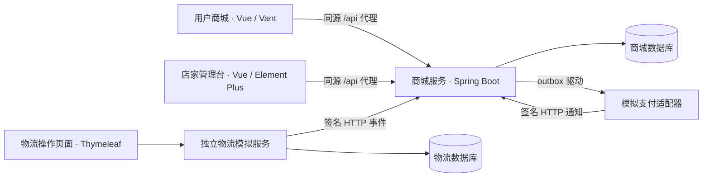

# TradeTrail · 商迹

**基于模块化单体的单店交易与履约演示系统。**

TradeTrail 将商品、购物车、订单、库存、支付、物流和售后串成可调试的交易流程。项目包含用户商城、店家管理台，以及独立运行、通过签名 HTTP 回调推送轨迹的物流模拟服务。

当前定位为课程演示与工程实践：支付和退款使用模拟渠道，订单、库存、交易记录及失败恢复使用真实持久化逻辑。已实现范围与未完成项分别记录，不将设计目标等同于生产就绪能力。

[快速启动](#快速启动) · [手工验收](docs/testing/manual-acceptance.md) · [接口与断点调试](docs/testing/debugging.md) · [验证记录](docs/delivery-checklist.md) · [设计方案](Plan.md)

## 核心能力

| 业务域 | 当前能力 |
|---|---|
| 商品与库存 | 商品创建、改价、上下架、库存调整及流水；历史订单保留成交快照 |
| 购物车与结算 | 选中结算、地址快照、服务端核价、库存预留、稳定请求号重试 |
| 订单 | 集中状态机、版本与状态审计、主动取消、超时关闭、确认收货 |
| 支付与退款 | 独立支付尝试、异步签名通知、迟到支付补偿、整单退款、失败后同号重试 |
| 履约与物流 | 售后阻断发货、独立运单、轨迹去重、摘要防倒退、异常恢复 |
| 售后 | 审核通过或拒绝、仅退款、退货运单、验收与合格库存回补 |
| 可靠性与验证 | outbox/inbox、租约恢复、人工重试、隔离测试库、MySQL 并发回归、浏览器验收 |

范围限定为**单店、单币种、单仓、单包裹、整单退款**。商品表单与接口金额单位均为分，页面展示为元。

## 系统结构



商城按业务域划分模块，物流模拟服务不访问商城数据库。订单与库存事实以数据库为准；Redis 仅作为可选开发服务，当前不参与业务处理。

| 目录 | 职责 |
|---|---|
| `tradetrail-domain` | 领域对象、订单状态机与仓储端口 |
| `tradetrail-application` | 业务用例、事务协调、事件与恢复 |
| `tradetrail-persistence` | MyBatis-Plus 与交易 SQL 实现 |
| `tradetrail-api` | 角色化 HTTP 接口、会话、鉴权、CSRF、幂等与错误合同 |
| `tradetrail-channel-mock` | 模拟支付通知协议与适配器 |
| `tradetrail-boot` | 商城启动、定时任务、配置、迁移与集成测试 |
| `tradetrail-logistics-simulator` | 独立物流录入、事件持久化与推送 |
| `frontend/customer` / `frontend/merchant` | 用户商城 / 店家管理台 |
| `frontend/shared` / `frontend/tests` | 共享请求与模型 / Playwright 验收 |
| `docs` / `ai-agent/tools` | 设计和调试文档 / 辅助脚本 |

## 环境要求

| 工具 | 要求与用途 |
|---|---|
| JDK | 21 |
| Maven | 3.9 系列 |
| Node.js | 建议 22.12+，用于两端构建和浏览器验收 |
| PowerShell | 本文命令按 PowerShell 7 编写；冒烟脚本使用 7 的 HTTP 参数 |
| Docker Desktop | MySQL 开发和 Testcontainers 集成测试需要；H2 启动不需要 |

后端采用 Spring Boot 3.5、MyBatis-Plus、Flyway；前端采用 Vue 3、TypeScript、Vite、Pinia。依赖版本以各模块构建文件与 lockfile 为准。

## 快速启动

以下终端均从仓库根目录开始。首次运行建议使用 H2；需要一套与既有开发数据分离的测试环境时，直接按[手工验收文档](docs/testing/manual-acceptance.md)启动。

### 1. 安装依赖并打包

```powershell
Set-Location D:\JavaCode\TradeTrail
mvn clean package
npm ci --prefix frontend/customer
npm ci --prefix frontend/merchant
```

若仓库位于其他目录，替换第一行。打包前先停止本项目正在运行的旧 JAR，避免 Windows 文件占用；不要在 JAR 运行时执行 `clean`。

### 2. 启动商城与物流服务

终端 A：

```powershell
java -jar tradetrail-boot/target/tradetrail-boot-0.1.0-SNAPSHOT.jar --spring.profiles.active=default
```

终端 B：

```powershell
java -jar tradetrail-logistics-simulator/target/tradetrail-logistics-simulator-0.1.0-SNAPSHOT.jar --spring.profiles.active=default
```

默认配置使用 `data/` 下的 H2 文件数据库，重启保留数据。若终端设置过 `SPRING_DATASOURCE_*` 等自定义参数，应先检查是否覆盖默认配置。两个服务出现 `Started ...Application` 后再启动前端。

### 3. 启动两端页面

终端 C：

```powershell
npm --prefix frontend/customer run dev
```

终端 D：

```powershell
npm --prefix frontend/merchant run dev
```

| 入口 | 地址 | 本地演示账号 |
|---|---|---|
| 用户商城 | http://127.0.0.1:5173 | `customer / customer123` |
| 店家管理台 | http://127.0.0.1:5174 | `merchant / merchant123` |
| 物流模拟端 | http://localhost:8081 | `logistics / logistics123` |
| 商城会话检查 | http://127.0.0.1:8080/session | 匿名也可返回 JSON |

**用户、店家使用不同浏览器配置文件，或普通窗口与无痕窗口。** Cookie 不按端口隔离，两个普通标签页无法保持独立角色会话。物流端使用 `localhost`，商城两端使用 `127.0.0.1`，减少同名会话 Cookie 冲突。

前端仅代理 `/api`，后端实际路径不带此前缀。修改商城端口时，需同时修改前端 `TRADETRAIL_API_TARGET`、支付 `tradetrail.payment.callback-url` 和物流 `tradetrail.mall-url`，详见[调试配置](docs/testing/debugging.md)。

### 4. 跑通第一笔交易

店家创建并上架商品 → 用户加购、填写地址、结算并模拟付款 → 店家发货 → 物流端提交轨迹 → 用户查看物流并确认收货。

接着用新订单验证取消、仅退款、退货退款和失败重试。每步操作、预期状态和库存断言见[手工验收清单](docs/testing/manual-acceptance.md)。

## 使用 MySQL

```powershell
docker compose up -d mysql
docker compose ps
```

等待 MySQL 为 `healthy` 后，停止原 H2 服务，在两个独立终端分别运行：

```powershell
java -jar tradetrail-boot/target/tradetrail-boot-0.1.0-SNAPSHOT.jar --spring.profiles.active=mysql
```

```powershell
java -jar tradetrail-logistics-simulator/target/tradetrail-logistics-simulator-0.1.0-SNAPSHOT.jar --spring.profiles.active=mysql
```

| 项目 | 默认值 |
|---|---|
| MySQL 主机端口 | `127.0.0.1:3310` |
| 商城数据库 | `tradetrail` |
| 物流数据库 | `tradetrail_logistics` |
| 本地数据库账号 | `tradetrail / tradetrail` |
| 可选 Redis | `docker compose up -d redis`；主机端口 `6382` |

MySQL 数据保存在 Docker 命名卷；H2 与 MySQL 数据不自动迁移。初始化 SQL 只在新 MySQL 数据卷创建时运行，旧卷缺少物流库时参见[数据库排错](docs/testing/debugging.md)。Flyway 自动执行各服务迁移，不要用删卷或修改迁移历史来处理启动错误。

## 测试与质量检查

均从仓库根目录执行：

```powershell
mvn test
mvn -Pmysql-it verify
npm --prefix frontend/customer run build
npm --prefix frontend/merchant run build
```

`mvn test` 使用隔离内存库；`mysql-it` 额外创建独立 MySQL 8.4 容器，不使用开发库。定向回归和测试报告位置见[接口与断点调试](docs/testing/debugging.md)。

浏览器验收首次准备与执行：

```powershell
npm ci --prefix frontend
Push-Location frontend
npx playwright install chromium
npm run format:check
npm run test:e2e
Pop-Location
```

先完成 Maven 打包和两端依赖安装。Playwright 自动启动隔离后端及两端页面，使用 `18080 / 15173 / 15174`，结束后关闭；不要占用这些端口。清除旧的 `MERCHANT_URL`、`CUSTOMER_URL` 环境变量后运行，避免误连接手工环境。报告位于 `frontend/playwright-report`，截图位于 `frontend/test-results`。

两个手工服务运行时，也可以执行：

```powershell
./ai-agent/tools/smoke.ps1
```

该脚本会向当前连接的库写入演示商品、订单和物流事件，成功输出 `PASS`。GitHub Actions 配置见 [verify.yml](.github/workflows/verify.yml)，本机历史验收结果见[交付记录](docs/delivery-checklist.md)；本机通过不等同于远端 CI 已通过。

## 文档导航

| 文档 | 阅读目的 |
|---|---|
| [手工验收与故障演练](docs/testing/manual-acceptance.md) | 准备测试数据、逐项操作页面、记录预期与实际结果 |
| [接口、断点与排错指南](docs/testing/debugging.md) | 复制接口请求、核对数据库、定位交易和环境问题 |
| [业务流程与接口说明](docs/implementation-roadmap.md) | 理解当前实现、接口变化和状态约定 |
| [交付检查与验证记录](docs/delivery-checklist.md) | 查看已验证范围和剩余差距 |
| [项目方案](Plan.md) / [后端设计](docs/design/TradeTrail-后端设计文档.md) | 理解设计目标和技术边界 |
| [订单状态机](docs/design/01-订单状态机.md) / [业务分层](docs/design/02-业务分层设计图.md) / [模块设计](docs/design/03-模块设计图.md) | 查看领域规则及架构图 |
| [开发规范](agent.md) | 模块边界、接口组织、测试和提交前检查 |

## 当前边界

- 支付与退款为 mock，不发生真实资金交易，演示账号与默认签名密钥仅用于本地环境。
- 已覆盖并发正确性回归，尚无容量压测结论或多实例生产验证。
- 退货寄回超时自动终止、物流异常独立工单、真实支付网关及全面数据库分页尚未完成。
- 物流协议使用 UTC 时间；新旧商城、前端与物流服务应配套更新。存量数据升级演练不在现有新库测试结论内。

完整差距保留在[交付检查](docs/delivery-checklist.md)，后续扩展以该记录和设计文档共同约束。
