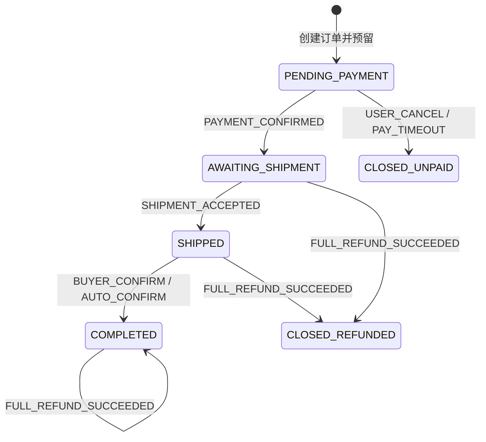
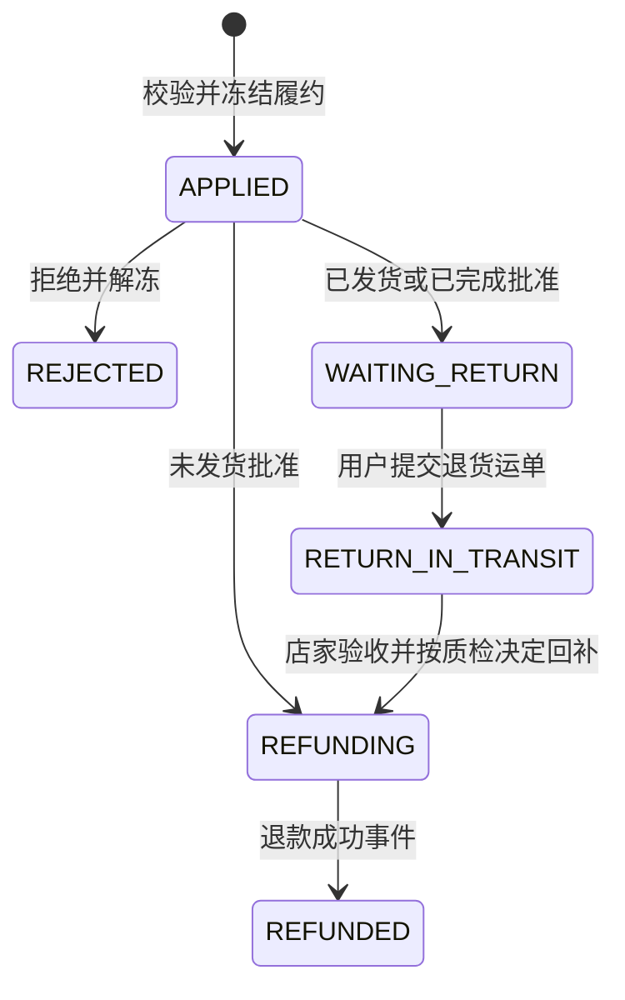

# TradeTrail 订单与相关状态机

核对日期：2026-10-29。状态名与当前代码、迁移一致；后续目标见 [Plan](../Plan.md)。状态规则的实现入口是 [OrderState](../../tradetrail-domain/src/main/java/com/tradetrail/domain/order/OrderState.java)。

## 1. 状态边界

主订单描述履约进度；支付、退款、物流和售后分别记录自己的事实。`fulfillment_hold` 是独立冻结标记，不是订单主状态。

| 对象 | 实际持久化状态 |
|---|---|
| 订单 | `PENDING_PAYMENT / AWAITING_SHIPMENT / SHIPPED / COMPLETED / CLOSED_UNPAID / CLOSED_REFUNDED` |
| 支付处理 | `INITIATED / SUCCEEDED / LATE_PAYMENT` |
| 支付渠道结果 | `PENDING / SUCCEEDED / FAILED`，独立于处理状态 |
| 退款 | `REQUESTED / FAILED / SUCCEEDED` |
| 库存预留 | `RESERVED / CONFIRMED / RELEASED / RESTOCKED` |
| 售后 | `APPLIED / REJECTED / WAITING_RETURN / RETURN_IN_TRANSIT / REFUNDING / REFUNDED` |
| 运单摘要 | `CREATED / PICKED_UP / IN_TRANSIT / OUT_FOR_DELIVERY / DELIVERED / EXCEPTION` |

物流 `RESUMED` 是输入事件，恢复后摘要为运输中或派送中；它不是长期保存的运单摘要。当前订单不使用旧设计中的 `PAID/CANCELLED/AFTER_SALE/DELIVERED` 主状态。

## 2. 主订单转换



| 事件 | 允许前态 | 额外条件及结果 |
|---|---|---|
| `PAYMENT_CONFIRMED` | 待支付 | 验证通知和渠道结果；预留转已售 |
| `USER_CANCEL` | 待支付 | 本人操作且未记录渠道成功；释放预留 |
| `PAY_TIMEOUT` | 待支付 | 已过期限且未记录渠道成功；释放预留 |
| `SHIPMENT_ACCEPTED` | 待发货 | 无冻结；同事务创建运单 |
| `BUYER_CONFIRM` | 已发货 | 本人操作、无冻结；不强制先妥投 |
| `AUTO_CONFIRM` | 已发货 | 妥投达到配置天数、无冻结 |
| `FULL_REFUND_SUCCEEDED` | 待发货、已发货、已完成 | 前两者退款关闭；已完成保留完成事实；按售后类型决定是否此时回补 |

已完成重复确认、已关闭重复取消等由应用服务识别已有结果；不意味着状态机允许任意重复事件。非法转换抛 `ORDER_TRANSITION_DENIED`。

状态变更采用订单行锁及预期版本/状态条件更新。订单状态、日志、相关库存转换和 outbox 在本地事务内完成。`allowedActions` 由主状态及冻结生成，只是动作提示，不包含完整角色、期限、库存和每单一个售后等校验。

## 3. 库存转换与回滚

```text
下单：可售 → 预留          RESERVED
支付：预留 → 已售          RESERVED → CONFIRMED
未付关闭：预留 → 可售      RESERVED → RELEASED
符合条件回补：已售 → 可售  CONFIRMED → RESTOCKED
```

每单每商品一条预留记录；条件转换与 `(order_id, product_id, action)` 唯一流水阻止重复处理。多商品固定顺序执行，第二项失败时第一项和订单整体回滚。库存调整有独立操作记录，不能误当作订单回补。

## 4. 支付、关单与迟到补偿

1. 创建支付尝试时订单仍待支付且未过期限；同订单返回已有尝试。
2. 收银台成功登记 `provider_status=SUCCEEDED`，发布通知，尚未代表订单确认成功。
3. 回调验证签名、通知身份、金额、渠道结果后锁定订单。待支付走正常确认；已关闭标记 `LATE_PAYMENT` 并创建退款。
4. 重复通知通过通知记录、幂等指纹和已处理状态返回；伪造或金额不符拒绝。
5. 取消、超时与回调使用相同订单锁。关闭后到账不重开订单、不占用已释放库存。

支付记录由 `UNIQUE(order_id)` 限制为一笔，退款由 `UNIQUE(payment_id)` 限制为一笔整单退款。不能将其描述为已经支持多渠道多次尝试、部分退款或额外收款补偿。

## 5. 售后转换与冻结



- 售后从待发货、已发货、已完成申请；完成后的期限默认 15 天。每订单一条工单，拒绝后当前实现也不创建第二条。
- 申请立即冻结，禁止发货、主动及自动确认；拒绝或成功退款释放冻结。
- 未发货类型为 `REFUND_ONLY`；发货后为 `RETURN_REFUND`。
- 退货质检合格时回补，不合格不回补，二者仍进入整单退款。
- 退款失败保存在 `refund_attempt`，售后仍为 `REFUNDING`。沿原退款号重试，不创建新退款或重复回补。
- 寄回期限自动终止尚未实现，不能写成自动解除冻结的现有规则。

## 6. 物流事件与摘要

正常进度为揽收 1、运输 2、派送 3、妥投 4。异常保留已有进度；`RESUMED` 要求当前异常，恢复到运输中或原有派送阶段。有效事件先写时间线，再决定是否推进摘要；旧发生时间及较低进度不倒退当前摘要，妥投后维持妥投。

事件时间不得超出当前数据库时间未来 5 分钟。服务间请求时间戳另有验签窗口；两者不是同一检查。节点时间采用 UTC，签名基于原始 JSON，不可在验签前重排字段。

物流妥投不直接完成订单；它为定时自动确认提供条件。时间线以当前查询排序为准，不承诺未实现的预计送达或独立异常工单。

## 7. 需要验证的竞争

| 场景 | 应观察的结果 |
|---|---|
| 相同下单键并发 | 一个订单和一次预留，同参数返回原结果 |
| 100 买家抢 10 件 | 10 次成功，其余库存不足，无负可售 |
| 支付与取消/超时 | 锁后重新判断，不同时出售和释放同一预留 |
| 售后与发货 | 按拿锁顺序及最新状态执行；冻结成立后禁止发货 |
| 重复退款成功事件 | 售后只完成一次，库存不重复增加 |
| 乱序物流、异常恢复 | 时间线保留有效节点，摘要不倒退 |
| 超过一批自动确认 | 游标继续处理后续记录，无前批阻塞 |

测试定位见[测试与调试](../testing.md)；生产多实例和进程故障的未验收范围见 [Plan](../Plan.md)。
