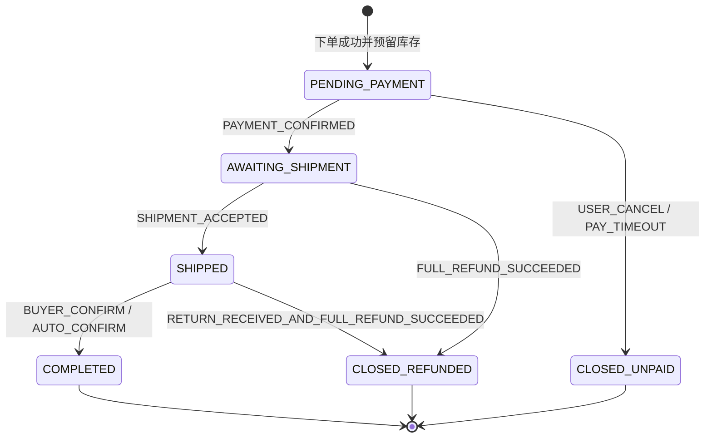
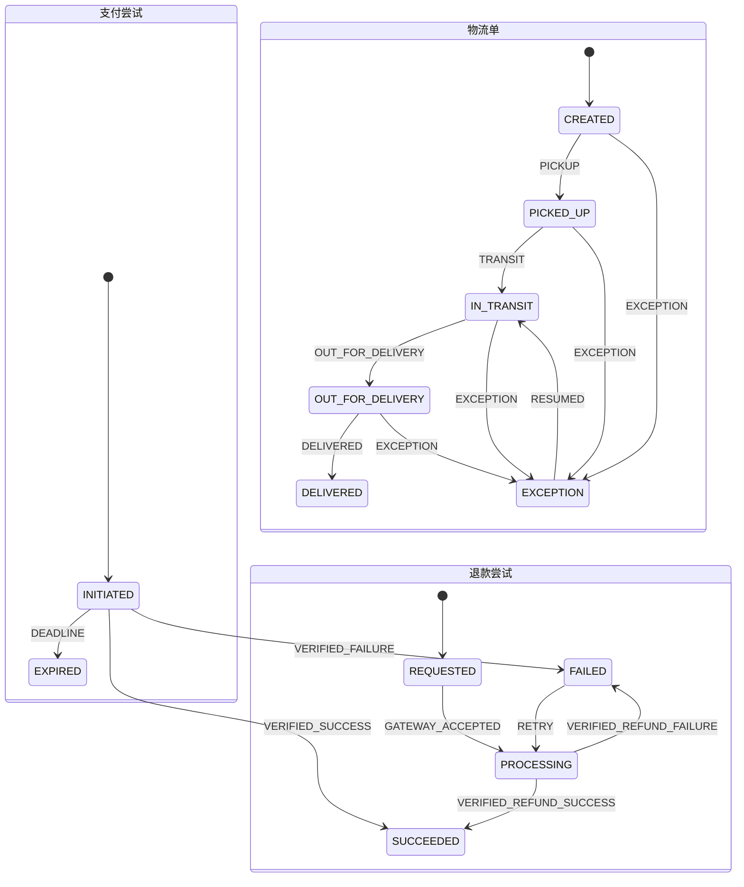

# TradeTrail（商迹）订单状态机

> 版本：v1 设计基线。课程交付支持整单下单、模拟支付、单包裹发货、物流轨迹、整单售后；字段和接口为多包裹、部分退款留扩展位。

## 1. 状态边界与不变量

订单主状态只描述**交易履约进度**。支付、物流、售后各有自己的状态机，不能把 `退款中`、`运输中` 塞进订单主状态，否则一笔已发货订单申请售后时会丢失物流位置。用户端订单详情由四种状态组成，展示文案是投影结果，不直接落成一个巨大枚举。店家管理端发货；独立物流模拟端推送轨迹，两者权限分离。

| 状态机 | 聚合/表 | 谁能改 | 核心不变量 |
|---|---|---|---|
| 订单 | `sales_order` | OrderApplicationService 经状态机 | 每次转移记录前态、事件、版本；终态不可逆 |
| 支付 | `payment_attempt`、`refund_attempt` | PaymentApplicationService | 同一订单最多接受一笔成功收款用于履约；额外到账须记录并补偿退款；退款累计额 ≤ 对应实收额 |
| 库存预留 | `inventory_reservation` | InventoryApplicationService | 可售量不为负；每个订单 SKU 的预留只确认或释放一次 |
| 物流 | `shipment`、`tracking_event` | 店家创建发货单；FulfillmentApplicationService 接收已验签的物流推送 | 轨迹按承运商事件 ID 去重；轨迹不能直接证明用户已确认收货 |
| 售后 | `after_sale_case` | AfterSaleApplicationService | 一次有效申请只关联一个处理流程；拒绝不回滚订单主状态 |

金额统一用整数分，数量为正整数。订单项保存 SKU 名称、规格、成交单价及优惠分摊快照。订单总额在支付创建后不可改；商品后续改价不影响历史订单。

## 2. 订单主状态图

`COMPLETED` 表示履约完成，**不是**售后权利消失；完成后申请售后不倒退主状态。v1 只支持整单退款；未来支持部分退款时仍保持订单主状态，使用 `refunded_amount`、`after_sale_summary` 展示。`CLOSED_REFUNDED` 只用于已支付但未完成履约、且已全额退款的订单。已完成订单若之后全额退款，主状态仍为 `COMPLETED`，财务视图显示 `FULLY_REFUNDED`。

### 2.1 转移表

| 当前状态 | 事件/发起者 | 守卫条件 | 原子动作与后续动作 | 下一状态 |
|---|---|---|---|---|
| 无 | `PLACE_ORDER` / 买家 | SKU 在售、数量合法、地址有效、价格重算、库存可预留、幂等键有效 | 同一数据库事务内写订单快照、库存预留、状态日志、待发布事件；设置支付截止时间 | `PENDING_PAYMENT` |
| `PENDING_PAYMENT` | `PAYMENT_CONFIRMED` / 已验签的支付通知或 mock 网关 | 支付单归属订单、金额币种相符、支付单成功、未过期关单；只有首次成功收款可推进 | CAS 改状态；确认预留为已售；写日志和 outbox | `AWAITING_SHIPMENT` |
| `PENDING_PAYMENT` | `USER_CANCEL` / 本人 | 未收到成功支付；仍在待支付 | CAS 关闭；释放预留；取消待支付任务；写日志 | `CLOSED_UNPAID` |
| `PENDING_PAYMENT` | `PAY_TIMEOUT` / 定时任务 | 数据库时间 ≥ `pay_deadline`；复核支付结果仍未成功 | CAS 关闭；释放预留；写日志；触发网关关单 | `CLOSED_UNPAID` |
| `AWAITING_SHIPMENT` | `SHIPMENT_ACCEPTED` / 店家管理端 | 无阻断发货的售后；生成的运单号在 `MOCK` 渠道唯一；发货项与订单项一致 | 写发货单；CAS 改状态；写日志/outbox | `SHIPPED` |
| `AWAITING_SHIPMENT` | `FULL_REFUND_SUCCEEDED` / 退款回执 | 有已批准整单仅退款申请；退款累计额 = 实收额 | CAS 关闭；恢复可售量；写日志 | `CLOSED_REFUNDED` |
| `SHIPPED` | `BUYER_CONFIRM` / 本人 | 发货单已存在；没有正在处理且需阻断确认的退货申请 | CAS 改状态；写确认时间与日志 | `COMPLETED` |
| `SHIPPED` | `AUTO_CONFIRM` / 定时任务 | 妥投后达到可配置期限；无阻断售后；用数据库时间复查 | CAS 改状态；写日志 | `COMPLETED` |
| `SHIPPED` | `RETURN_RECEIVED_AND_FULL_REFUND_SUCCEEDED` / 售后编排 | 退货签收，退款成功，整单退款总额 = 实收额 | CAS 关闭；退货入库质检另行处理；写日志 | `CLOSED_REFUNDED` |

**终态**：`CLOSED_UNPAID`、`CLOSED_REFUNDED` 对主流程为终态；`COMPLETED` 对履约主流程为终态，但售后子流程可以继续。取消与超时只释放预留，不“加回一次已扣库存”。支付后发货前退款成功才回补可售量；退货收到后的库存由质检决定是否重新入库，不能自动加回。

### 2.2 守卫、权限和错误

`Guard` 同时检查业务条件和当前持久化版本，前端传来的状态不能作为依据。用户只能操作自己的订单；店家只能管理官方店铺商品、库存和订单；物流操作者不能调用店家接口。支付回调校验签名、时间戳、金额、订单号；物流回调校验签名、时间戳、运单号、渠道。非法转移返回 `ORDER_TRANSITION_DENIED`，并包含当前可用动作；版本冲突返回 `ORDER_CONFLICT`，调用方重新读取后决定是否幂等成功。状态日志记录 `order_id/from/to/event/actor/command_id/trace_id/occurred_at`，涉及个人信息的原始回调按保留期限脱敏。

状态机以 `(from, event) -> guard + action + to` 转移表实现。**副作用不可藏在状态对象里**：状态机判定及生成领域事实，应用服务在事务中保存订单、库存、日志、outbox；外部支付/物流调用由事务后可靠投递执行。并发写入使用 `WHERE id = ? AND version = ? AND status = ?`，影响行数必须等于 1。

## 3. 并行状态机

物流轨迹是**追加事件**。v1 的独立物流模拟服务由物流操作者录入揽收、运输、派送、妥投、异常节点，通过签名 HTTP 回调主动推送商城；未来真实承运商也可用相同的商城侧端口。事件可能重复或乱序，展示按发生时间排序，同时保存接收时间。`shipment.status` 只作为当前摘要，不因收到旧轨迹而倒退。物流异常不会自动取消已支付订单，而是创建待处理异常工单。用户端查询商城本地轨迹；店家端不能直接补写物流状态。

售后流程：`APPLIED → REVIEWING → APPROVED/REJECTED`；批准仅退款后为 `REFUNDING → REFUNDED/REFUND_FAILED`；批准退货退款后为 `WAITING_RETURN → RETURN_IN_TRANSIT → RETURN_RECEIVED → REFUNDING → REFUNDED`。`REJECTED` 与 `REFUNDED` 为售后工单终态。商家审核、退款失败重试、退货超时、售后期限等由售后模块负责。v1 先实现整单仅退款（未发货）及整单退货退款（已发货/已完成）；售后申请期限配置化，默认演示值不宣称法定期限。

## 4. 核心竞争与恢复

| 情况 | 处理规则 | 验收断言 |
|---|---|---|
| 同一请求重复下单 | `(user_id, client_request_id)` 唯一；同键同参数返回原订单，异参拒绝 | 只产生一单一笔预留 |
| 多人抢最后一件 | 数据库条件扣减 `available >= qty`；订单与预留同事务 | `available >= 0`，仅一单成功 |
| 支付通知重复/乱序 | `(channel, provider_event_id)` 唯一；支付尝试按单调转移 | 只推进订单一次、不重复确认库存 |
| 支付成功与关单并发 | 先向网关查询/关单并按同一订单锁序列化；关单先赢且之后收到成功款，登记 `late_payment` 并发起补偿退款 | 不丢款，订单不会同时关闭和待发货 |
| 发货与售后申请并发 | 共用订单版本/行锁；售后受理时设置 `fulfillment_hold`；发货守卫读取该标记 | 只发生“发货成功”或“售后阻断发货”之一 |
| 物流回调伪造/未知运单 | 先验 HMAC 签名与时间窗口，再检查 `MOCK` 运单是否存在且已发货 | 无效请求不能写轨迹或改订单 |
| 物流回调重复/乱序 | `(carrier, tracking_no, provider_event_id)` 唯一，旧事件不倒退摘要；重复推送返回成功 | 时间线无重复、摘要单调 |
| outbox 消费失败 | 保留未投递记录，指数退避重试，消费者用 `event_id` 去重 | 最终可恢复，无重复副作用 |
| 退款调用超时 | 先按 `refund_request_id` 查询网关，再决定重试；不可凭超时认定失败 | 不多退一笔 |

支付与超时的最终一致性要靠**支付尝试与补偿退款流水**证明，不能仅靠订单 CAS 宣称资金一致。外部网关调用不放在数据库事务中；调用失败通过状态和 outbox 重试。mock 网关也保留独立回调链路，以便演示重复通知、延迟通知、验签失败。

## 5. 建议测试集

1. 转移表：每个合法转移、全部非法转移、守卫拒绝、终态不可逆。
2. 属性约束：任意事件序列下库存不负、退款不超实收、同一成功支付不多次推进订单。
3. 并发集：抢购、重复下单、支付/超时、发货/售后、重复退款回调。
4. 故障集：事务提交后进程崩溃、outbox 重试、支付请求超时后查询、物流服务推送失败后重试、轨迹乱序与伪造签名。
5. 演示数据：一单正常签收，一单超时关闭，一单延迟支付自动补偿，一单物流异常，一单售后退款。
