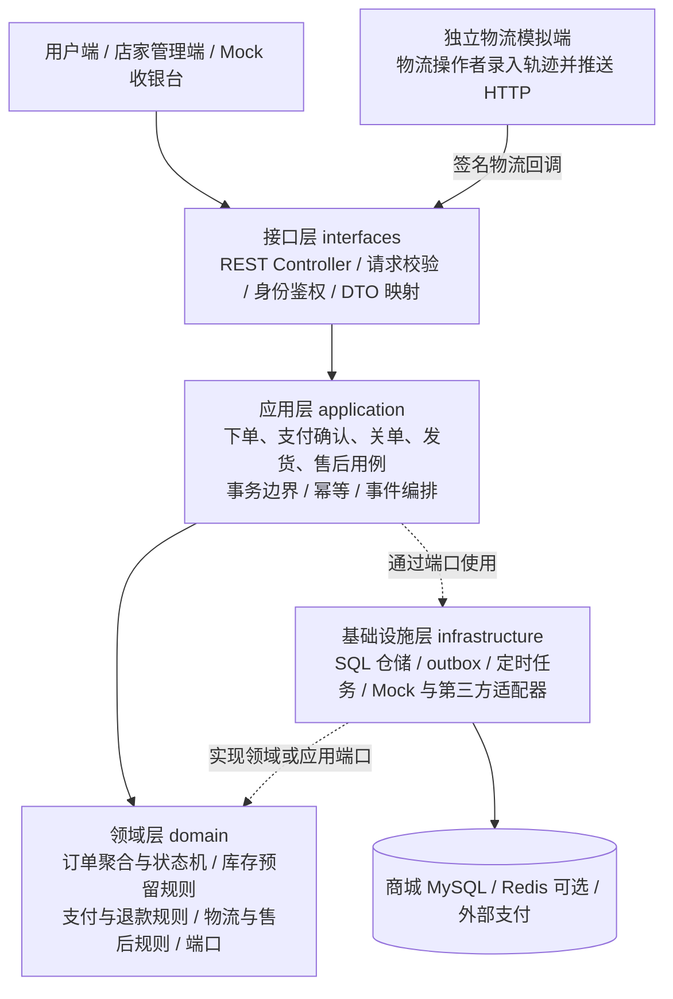
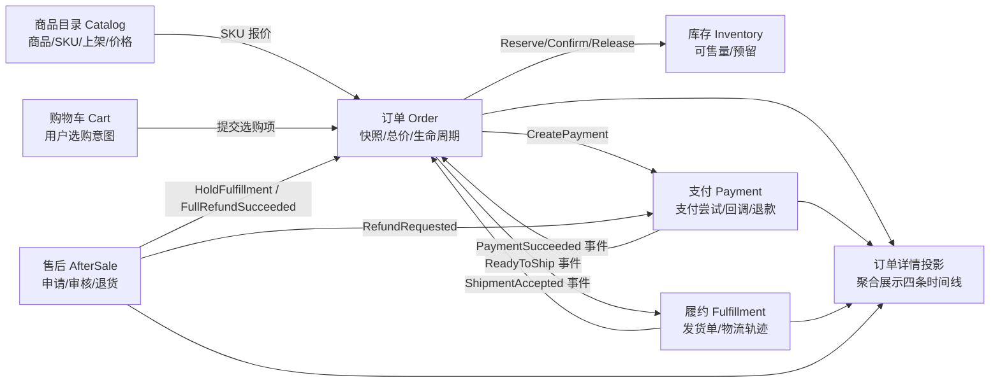
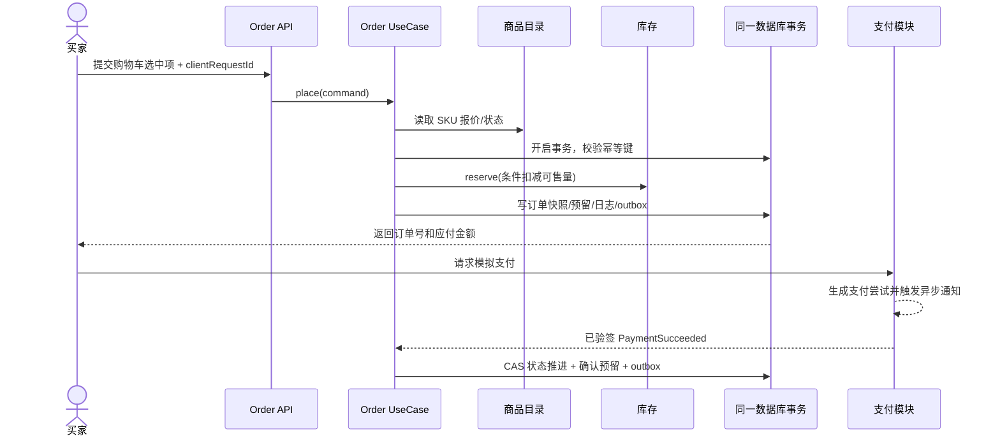
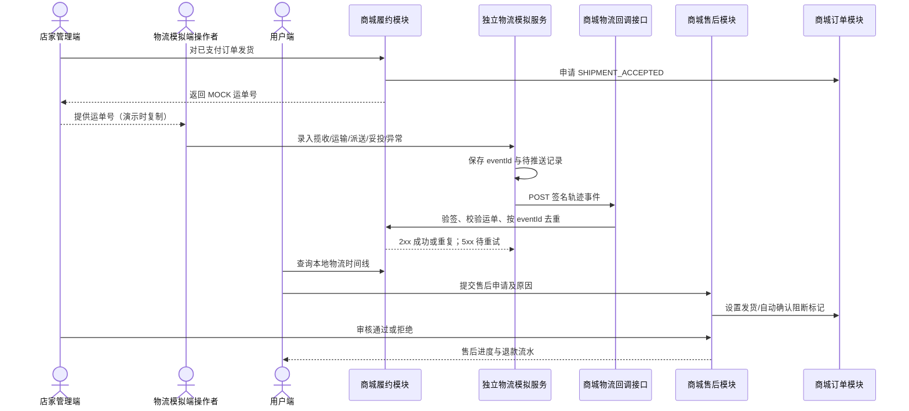

# TradeTrail（商迹）业务分层设计图

## 1. 纵向分层与依赖方向

图中的应用层到基础设施层虚线表示**运行时调用**，不是源码依赖。源码依赖仅为 `interfaces → application → domain`、`infrastructure → domain/application`，启动模块负责装配。领域对象不 import Spring、ORM、HTTP SDK；应用层不直接写 SQL。跨业务模块只能依赖其公开 API 或订阅其公开事件，不可引用对方 `internal` 包、表映射器或实体。物流模拟端是独立进程，只通过签名 HTTP 回调进入商城接口层，不共享商城数据库。

| 层 | 放什么 | 不放什么 | 示例 |
|---|---|---|---|
| 接口 | 用户/店家 REST、角色鉴权、物流签名原文接收、错误码映射 | 价格计算、状态改写、直接操作仓储 | `POST /orders`、`POST /callbacks/logistics/mock` |
| 应用 | 用例编排、事务、幂等记录、跨聚合协调、outbox | 渠道 SDK、复杂业务规则散落在 service 里 | `PlaceOrderUseCase`、`HandlePaymentNoticeUseCase` |
| 领域 | 聚合、值对象、状态机、守卫、领域事件、仓储与网关端口 | Spring 注解、表结构细节、外部报文 | `Order.transition()`、`InventoryReservation.confirm()` |
| 基础设施 | MyBatis-Plus 仓储、SQL 迁移、Mock/真实渠道适配器、事件投递、时钟 | 绕过应用层直接修改订单 | `MyBatisPlusOrderRepository`、`MockPaymentGateway` |

## 2. 业务域分层：谁拥有数据和规则

用户端和店家管理端调用同一商城服务的不同接口：用户只读公开商品并操作自己的购物车/订单；店家发布商品、录入 SKU 初始库存、调整库存、发货和审核售后。v1 只有一个官方店铺，因此不引入多商家结算。物流操作者不属于商城店家角色，其独立系统只负责运单轨迹，无法直接修改订单或库存。

每个业务域独占自己的表写权限；跨域事件是**事实通知**，需要立即拿到结果的操作用显式公开接口。`Order` 不直接操作 `payment_attempt` 表，`Payment` 不直接更新 `sales_order`。订单详情读模型可以读取各域公开查询接口，后期可换成异步投影；课程版本无需先做复杂 CQRS 基础设施。

## 3. 两条关键业务时序

### 下单与支付

商品报价读取与最终下单可能跨越价格变化：在订单事务内必须再次校验 `sku_version` 和成交价，价变则返回最新报价供用户确认。v1 使用同一个 MySQL 数据库和本地事务保证订单与库存预留原子性，Redis 只可做缓存/限流，不能成为唯一库存账本。

### 物流系统主动推送与售后

商城是订单和运单的权威数据源，物流模拟服务是轨迹事件的来源。物流服务不能拿商城数据库连接；商城收到物流事件时不向物流服务做同步反查，避免循环依赖。重复事件返回成功，临时失败由物流服务用同一 `eventId` 重试。商城轨迹详情只查询本地表，所以物流服务短暂离线时用户仍能看到已接收的记录。

## 4. 设计模式的落点

| 模式 | 用在何处 | 解决的具体问题 | 避免的误用 |
|---|---|---|---|
| 状态模式 + 转移表 | 订单/支付/售后各自的转移与守卫 | 非法状态转移、规则散落 | 不给每个状态都造空类；规则简单时用表驱动 |
| 策略 + 注册表 | `PaymentGateway`、`TrackingProvider` 按渠道路由 | mock 与真实渠道可替换/并存 | 支付尝试与发货单固定渠道，不随默认渠道变更漂移 |
| 适配器/端口 | 第三方支付与物流回调转成内部语义 | HTTP 协议与签名细节不侵入业务域 | 不把外部字段直接暴露为领域模型 |
| 责任链 | 下单前的商品、限购、地址、风控校验 | 规则可增删且顺序明确 | 库存写入不放在只读校验链里 |
| 工厂/建造者 | 从已核价 SKU 和地址生成不可变订单快照 | 防止漏字段、价格漂移 | 不为简单 DTO 制造层层 builder |
| 观察者 + outbox | 订单已支付、已发货等事实发布 | 跨模块扩展、故障后重投 | 不把内存事件当作可靠消息 |
| 模板方法 | 支付通知处理固定验签、去重、校验、应答步骤 | 渠道回调处理一致 | 通用流程放应用层；渠道差异留在适配器 |
| 仓储 + 规格 | 订单聚合持久化与可复用查询条件 | 隔离 SQL，支持测试 | 不做泛型万能仓储 |

设计模式是为了让业务变更有固定位置。每个模式至少用一个真实用例和测试证明价值。
