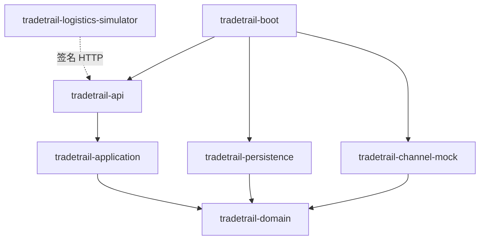

# TradeTrail 业务分层与数据所有权

核对日期：2026-10-29。本页使用实际 Maven 模块和包名描述依赖。编码维护要求见 [agent.md](../../agent.md)，范围及差距见 [Plan](../Plan.md)。

## 1. 模块依赖



| 层 | 实际包例子 | 职责 |
|---|---|---|
| API | `com.tradetrail.api.customer.order` | HTTP、DTO 校验、身份入口、响应和错误 |
| 应用 | `com.tradetrail.application.order` | 用例、事务、锁顺序、跨域协调 |
| 领域 | `com.tradetrail.domain.order` | 纯 Java 状态规则、记录对象、存储端口 |
| 持久化 | `com.tradetrail.persistence.order` | MyBatis 实体、Mapper、领域端口实现 |
| 渠道 | `com.tradetrail.channel.mock` | mock 支付签名交互、物流协议适配 |
| 启动 | `com.tradetrail`，boot 模块 | 装配、应用入口、定时任务和集成测试 |

当前业务编排主要位于应用服务，领域层相对精简；不宣称已实现复杂领域聚合或全套 DDD。`internal` 是后续新增私有实现的边界约定，不表示现有所有类都已拆入该目录。

## 2. 业务所有权

| 业务域 | 公开应用入口 | 负责写入 |
|---|---|---|
| catalog | `CatalogService` | `product`；通过库存服务协调初始库存和调整 |
| cart | `CartService` | `cart_item` |
| order | `OrderService` | `sales_order/order_item/order_status_log` |
| inventory | `InventoryService` | `stock/inventory_reservation/stock_ledger/stock_adjustment` |
| payment | `PaymentService/PaymentQueryService` | `payment_attempt/payment_notice/refund_attempt` |
| fulfillment | `FulfillmentService` | `shipment/tracking_event` |
| after_sale | `AfterSaleService` | `after_sale_case/after_sale_action` |
| integration | `CommandService/EventService/OutboxDispatcher` | `idempotency_record/outbox_event/inbox_event` |

Controller 不直接注入 Mapper 或存储实现。应用服务访问本域领域端口；跨域动作调用对方公开应用服务，例如订单调用库存、售后调用订单与支付。查询 SQL 可在负责该查询的基础设施适配器内组合所需视图，但不能借跨域 SQL 暗改其他域的数据。

独立物流的 `sim_tracking_event` 只由物流服务负责；商城只接收公开 HTTP 事件。测试中的只读 SQL 和数据准备不代表业务代码获得跨域写权限。

## 3. 事务与并发

商城订单、库存、支付和售后在同一数据源中，通过本地事务保持相关写入一致。HTTP 业务写入口外层有幂等事务，应用服务仍明确声明事务，以支持回调、定时任务和测试直接调用。

```text
参数/身份校验
  → 幂等命令锁
  → 相关业务行锁与最新状态检查
  → 条件更新及影响行数检查
  → 业务记录 / 快照 / 流水 / outbox
  → 提交
```

具体锁序以业务调用链为准：购物车结算先串行化本人购物车，订单创建按商品 ID 排序锁报价；支付、取消、发货和售后修改已有订单时锁定订单。不能把上面示意图当作所有场景的统一锁顺序。

MySQL 使用 READ COMMITTED，MyBatis 会话缓存设置 STATEMENT，避免等待订单锁后仍读到旧支付状态。已有行锁不替代条件更新及版本校验；这些机制各自约束不同入口和重复执行。

外部 HTTP 不属于数据库原子事务。业务事实与待投递记录先持久化，后续通过重试和幂等恢复；不能将“本地事务提交”解释成远端已完成。

## 4. 渠道与扩展边界

领域定义 `PaymentGateway/TrackingProvider` 等端口，mock 模块实现相应协议。支付投递器按加载的渠道实例建立映射；当前只有 MOCK，不提供运行时加载新 JAR、动态切换存量交易渠道或真实网关查询。

新增渠道时要先明确请求号、签名、金额、通知、查询及退款合同，再加入适配器和合同测试。沿用状态机、端口、outbox 等已有变化点即可；没有实际需求时不额外引入责任链、模板方法、消息队列或微服务拆分。

## 5. 前端边界

```text
customer/pages 或 merchant/pages
    → 各自 api.ts 导出
    → frontend/shared/http.ts + models.ts
    → /api 代理
    → 商城角色化 Controller
```

页面及 Pinia 管理会话、购物车界面状态和交互。服务端是商品金额、库存、归属、允许操作与最终状态的来源。共享层只放两端实际复用的协议与请求逻辑，不放店家审核等页面业务。

物流端是 Thymeleaf 页面，不强制复用 Vue 状态管理或构建链。样式规范以各入口实际使用的样式文件为准，见 [UI Skill](../../ai-agent/skills/tradetrail-ui/SKILL.md)。

## 6. 维护验证

[ArchitectureTest](../../tradetrail-boot/src/test/java/com/tradetrail/architecture/ArchitectureTest.java) 验证部分依赖和仓储归属约束；不能因测试通过就声称所有跨域语义已自动检查。接口、真实数据库及浏览器测试分别覆盖输入合同、事务竞争和实际交互，三者不能互相替代。

每次变更核对入口、应用规则、持久化、事件消费者和页面调用。文档变动检查链接与命令即可；交易逻辑变化再运行受影响回归。只在用户明确授权时提交或推送。
