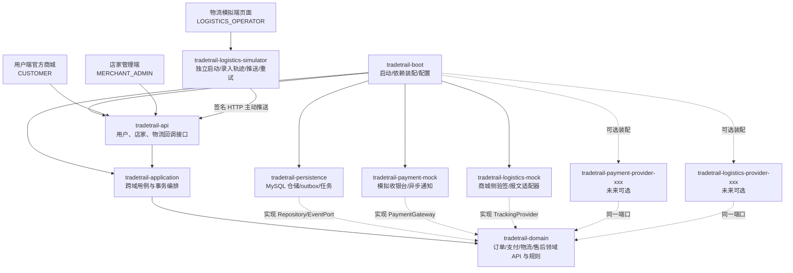
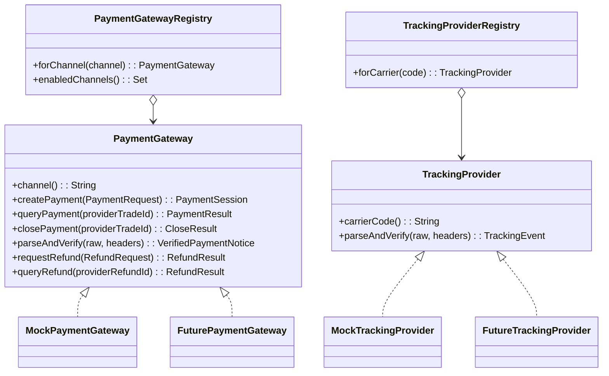

# TradeTrail（商迹）模块设计图

## 1. 模块全景

商城核心先做**单进程、业务模块化的 Spring Boot 应用**，用 Maven 多模块管住编译依赖。另做一个很小的物流模拟服务，作为独立进程主动推送轨迹；两者可用开发脚本或容器编排一起启动。用户端与店家管理端共享商城后端、分开路由和权限；物流端有自己的页面和后端，不访问商城数据库。



`tradetrail-logistics-simulator` 是**独立应用**，不是商城内的领域模块。它只保存模拟运单事件和投递结果，可用文件模式 H2；商城用 MySQL 保存正式发货单和轨迹。两边按运单号关联，不共享表。物流模拟端是第三个演示入口，不要求真实快递账号或公网回调地址，本地两个端口即可演示。

`domain` 内以 `catalog/cart/order/inventory/payment/fulfillment/after_sale` 分包，公开 `api`、`event`、`port`，实现放 `internal`；若 Maven 域模块以后拆开，公开合同即可迁移。为避免“所有东西都在大 domain 包”的假模块化，CI 增加 ArchUnit 或 Spring Modulith 的模块依赖验证：无循环、只能访问公开 API、禁止访问其他域的仓储与 internal 包。Spring Modulith 是可选验证工具，不要求它与 Maven 多模块同时承担两套模块发现规则。

## 2. 端口合同与插件生命周期



| 插拔动作 | v1 能力 | 规则 |
|---|---|---|
| 更换默认支付渠道 | 运行时可改后台配置，**只影响新支付尝试** | 已创建支付尝试记录 `channel`，回调和退款始终路由原渠道 |
| 暂停某渠道接新单 | 运行时禁用新交易入口 | 旧订单的查询、回调、退款能力必须继续可用 |
| 加入新的支付/物流实现 | 新增独立适配器 JAR，注册端口后部署重启 | 不改领域与应用层；不承诺 JVM 中无重启加载新类 |
| 停用旧适配器 | 先清点未结支付与退款/在途运单 | 有存量单时保留只读和回调/退款路径，直到安全退出 |

“热插拔”在此具体指**现有适配器运行时路由与启停、未来适配器按端口接入**。真正无重启装载新 JAR 涉及类加载隔离、线程与连接回收，课程阶段不做。路由表构建时检查 `channel` 唯一、缺失默认渠道则启动失败；管理配置更新须有审计日志。Mock 支付只在开发/演示环境开启，收银台模拟成功不能直接调用订单改状态，必须走通知验证和幂等处理。

物流的可替换点在**商城侧** `TrackingProvider`：v1 的 `MockTrackingProvider` 验证模拟服务的签名并解析回调；以后换成真实物流平台的适配器。v1 只需要“接收推送”能力，不为尚未使用的查询/订阅方法写空实现；未来若渠道需要主动查询，再新增独立查询端口。模拟服务本身只负责人工录入、持久化待推送事件和 HTTP 重试，不依赖商城的领域 JAR。发货单持久化 `carrierCode`，存量运单始终交给原适配器解释。

### 三端权限与职责

| 入口 | 允许的写操作 | 不能做的事 |
|---|---|---|
| 用户端 `CUSTOMER` | 改自己的购物车、下单、模拟支付、确认收货、申请售后 | 改商品售价和库存、给自己发货、伪造轨迹 |
| 店家管理端 `MERCHANT_ADMIN` | 发布/上下架商品、SKU 初始库存和调整、订单发货、售后审核 | 直接将支付标记成功、替物流端写轨迹 |
| 物流模拟端 `LOGISTICS_OPERATOR` | 对输入的运单号录入物流节点、查看投递状态、重试失败推送 | 读订单金额与用户隐私、改订单或库存 |

商城中 v1 只有一个官方店铺，店家账号代表该店铺；表结构可保留 `shop_id` 扩展位，但业务查询不引入多商家租户隔离的复杂度。库存“写入”分成创建 SKU 时录入初始数量、之后用有原因的**库存调整单**增减，禁止用无审计的绝对值覆盖并发库存。

## 3. 数据所有权与接口

| 域模块 | 自有表 | 对外公开能力/事件 |
|---|---|---|
| catalog | `product`, `sku` | `quote(skuIds)`；商品上架/下架管理 |
| cart | `cart_item` | 加购、改量、勾选、结算预览 |
| order | `sales_order`, `order_item`, `order_status_log`, `idempotency_record` | 下单、取消、详情、状态转移；`OrderPlaced/Paid/Closed` |
| inventory | `stock`, `inventory_reservation`, `stock_ledger` | `reserve/confirm/release/restock`，每个操作有业务幂等键 |
| payment | `payment_attempt`, `payment_notice`, `refund_attempt` | 创建支付、处理通知、发起/查询退款；`PaymentSucceeded/RefundSucceeded` |
| fulfillment | `shipment`, `tracking_event`, `shipment_exception` | 店家发货、接收已验签推送、轨迹查询；`ShipmentAccepted/Delivered` |
| after_sale | `after_sale_case`, `after_sale_action` | 申请、审核、寄回、签收、退款进度；`FulfillmentHoldRequested` |
| integration | `outbox_event`, `inbox_event`, `scheduled_task` | 发布、投递、重试、死信查看 |

关键唯一约束：`sales_order(user_id, client_request_id)`、`payment_notice(channel, provider_event_id)`、`tracking_event(carrier, tracking_no, provider_event_id)`、`refund_attempt(refund_request_id)`、`inbox_event(consumer, event_id)`。支付通知的 `provider_event_id` 不保证覆盖所有渠道，适配器必须按渠道合同构造稳定去重键，并另用支付单/订单状态判重。

物流模拟服务单独持久化 `sim_tracking_event(event_id, tracking_no, status, location, occurred_at, delivery_state, retry_count)`，不直接写商城的 `tracking_event`。店家发货时商城生成 `MOCK` 运单号；物流操作者在模拟端输入该号，商城回调接口负责拒绝未知或不属于 `MOCK` 渠道的运单。

### 面向课程的最小 API

| 入口/角色 | 接口 | 要点 |
|---|---|---|
| 店家管理端 | `POST/PUT /admin/products`、`POST /admin/skus/{id}/stock-adjustments` | 发布商品、SKU 初始库存与有原因的库存调整 |
| 用户端 | `GET /products`、`POST/PUT/DELETE /cart/items` | 商品浏览、购物车 |
| 用户端 | `POST /orders`、`GET /orders/{id}`、`POST /orders/{id}/cancel` | 幂等键、订单快照、当前可用动作 |
| 用户端 | `POST /orders/{id}/payments`、`POST /mock/checkout/{sessionId}/complete` | 模拟支付，支付状态通过回调异步更新 |
| 店家管理端 | `POST /admin/orders/{id}/shipments` | 已支付订单发货，生成并返回 `MOCK` 运单号 |
| 物流模拟端 | `POST /simulator/tracking-events`、`GET /simulator/deliveries` | 录入轨迹并查看成功/失败/待重试状态 |
| 商城回调入口 | `POST /callbacks/logistics/mock` | 仅物流服务调用；验签、验运单、去重、落库 |
| 用户端 | `GET /orders/{id}/tracking` | 本地轨迹时间线、异常提示、最近更新时间 |
| 用户端 | `POST /orders/{id}/after-sales`、`GET /after-sales/{id}` | 仅退款、退货退款及进度 |
| 店家管理端 | `POST /admin/after-sales/{id}/decisions` | 审核与原因记录 |

商城用户和店家写接口带 `clientRequestId` 或 `Idempotency-Key`；服务端从身份确定 `userId/role`，不信任请求体中的身份。金额由服务端重新计算。物流回调使用事件 ID 幂等和服务间签名，不使用用户登录态；物流模拟端操作者登录只用于录入事件，不能把浏览器请求直接当作可信物流回调。

### 物流回调最小协议

```json
{
  "eventId": "evt-10001",
  "carrierCode": "MOCK",
  "trackingNo": "TT202610210001",
  "status": "IN_TRANSIT",
  "location": "香港分拨中心",
  "description": "包裹已到达分拨中心",
  "occurredAt": "2026-10-21T14:30:00+08:00"
}
```

模拟服务以 `timestamp + '.' + 原始 JSON 字节` 计算 HMAC-SHA256，分别放入 `X-Logistics-Timestamp` 和 `X-Logistics-Signature`；商城使用同一密钥验签，检查时间窗口、已知运单、合法状态与唯一 `eventId`。密钥放环境配置，不写进前端。商城返回 2xx 表示已接收或重复，5xx 由模拟服务保留相同 `eventId` 重试，4xx 展示给物流操作者修正。商城按发生时间展示轨迹，按可靠的最新事件维护摘要；轨迹妥投不直接确认订单收货。

## 4. 模块验证与演进

1. 编译期：`domain` 无 Web、ORM、Redis、支付 SDK 依赖；插件只依赖端口 API。
2. 架构测试：禁止跨域访问 `internal`，禁止环，禁止 Controller 直接依赖 Repository。
3. 合同测试：同一组测试跑 mock 与未来真实适配器沙箱，覆盖查询、重复通知、超时、退款。
4. 运行观察：订单号贯穿日志，核心指标包括下单失败率、支付回调延迟、库存预留超时、outbox 积压、物流轨迹延迟、退款失败数。
5. 演进条件：只有当单进程在吞吐、团队部署或故障隔离上出现明确瓶颈，才考虑拆服务；拆分前先把公开事件与数据所有权稳定下来。
