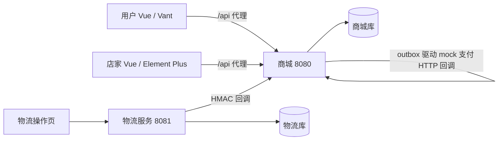
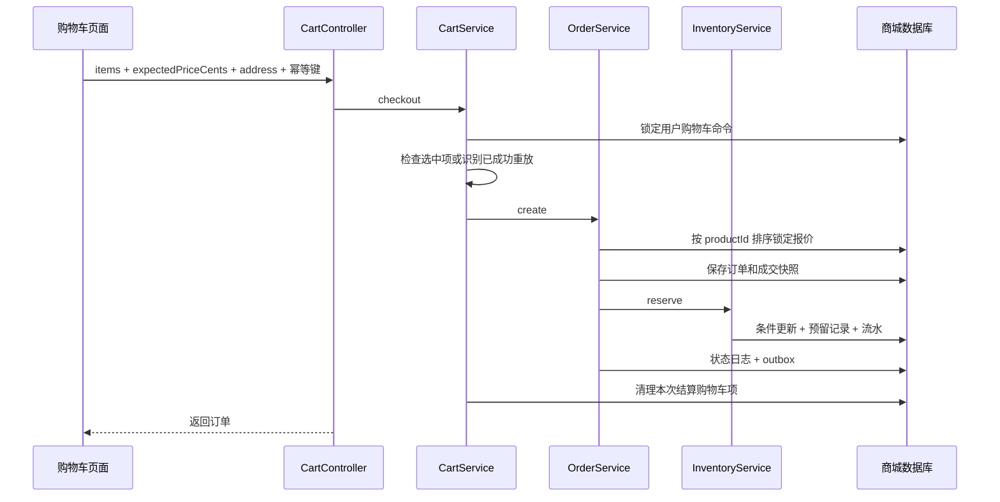

# TradeTrail 后端设计与业务阅读指南

核对日期：2026-10-29。本页按当前代码解释业务调用链。项目范围、缺口与历史验收统一见 [Plan](../Plan.md)，不再另设路线图或交付清单。

## 1. 运行组成

商城是一个 Spring Boot 多模块进程，服务用户商城和店家管理台；独立物流服务提供 Thymeleaf 页面并通过签名 HTTP 推送。两服务各自持有数据库和 Flyway 迁移。默认使用 H2 文件，`mysql` profile 切换 MySQL。

两个前端共享请求模块，但独立构建、独立启动。用户与店家在同一主机名下的会话 Cookie 不按端口隔离，本地演示应分开浏览器配置文件。

## 2. 请求入口与安全

浏览器请求 `/api/...`，Vite 去掉 `/api` 再代理到商城。直接调后端使用 `/orders` 等实际路径，不加 `/api`。

`SecurityConfig` 负责 Session 登录、角色与 CSRF。GET 商品和 `/session` 可匿名；`/admin/**` 要求店家角色，订单和购物车要求用户角色；资源归属在应用服务再次校验。回调不使用用户登录，但必须通过渠道签名与业务校验。

业务写请求经过 `IdempotencyFilter`：校验键、读取原始请求体、锁定用户与请求键对应记录，以方法/路径/请求体生成指纹，成功时保存 HTTP 状态和响应；同键异参返回冲突。过滤器使用事务模板，应用服务通过 `@Transactional` 保持自身用例边界。登录和会话操作不采用业务幂等键。

前端 [http.ts](../../frontend/shared/http.ts) 处理 Cookie、CSRF、统一错误、15 秒超时、同一进行中写请求合并及网络不确定结果的原键重试。页面路由与按钮只是交互入口，不能替代服务端权限和状态守卫。

## 3. 购物车到订单

`OrderService.create` 同时被购物车结算和直接下单调用。校验地址、数量、重复商品、上架状态与期望价格；金额取服务端报价。订单保存商品名称、成交单价、数量和地址，不保存尚未实现的优惠或运费分摊。

多商品固定顺序处理。任一商品库存不足，抛出业务异常，订单、此前库存更新、日志和事件整体回滚。`StockMapper` 的 `available >= quantity` 条件与影响行数检查共同决定是否预留成功；不能先在 Java 中检查库存再无条件扣减。

## 4. 支付与关单

`PaymentService.create` 锁定订单，校验归属和支付期限，创建或返回唯一支付尝试。`simulate` 只保存渠道结果并发布 `PAYMENT_NOTICE`。调度器经 `MockPaymentGateway` 发送签名 HTTP 回调，`PaymentCallbackController` 验签后调用 `receive`。

`receive` 验证通知参数、金额和渠道成功记录，锁定订单，保存通知去重事实：

- 待支付：确认支付并把库存预留转已售。
- 已未付关闭：标记迟到支付，创建原支付关联的补偿退款，不重新下单或占用库存。
- 重复成功事实：安全返回；不允许其他状态随意推进。

取消、超时和支付共用订单锁。若已记录渠道成功，关单拒绝或等待通知处理，避免先释放已收款订单的库存。`TradeJobs.lifecycle` 负责超时及自动确认，执行时重新检查状态和时间条件。

## 5. 发货、物流与收货

`FulfillmentService.ship` 锁定订单，经订单状态机检查待发货及无售后冻结，再创建唯一 `MOCK-...` 运单。重复发货已有结果时返回原订单。

物流服务保存事件后签名推送。商城按 `eventId` 去重、验证运单和时间，保存轨迹后维护摘要：旧时间/低进度事件不倒退摘要，妥投后保持妥投；异常恢复保留原派送进度。用户只查询商城本地轨迹，不直接调用物流数据库。

发货后用户可主动确认，不要求先录入妥投。自动确认要求妥投达到配置天数、订单仍发货中且没有售后冻结，并以游标分批扫描。物流妥投本身不直接把订单改成完成。

## 6. 售后、实物和退款

`AfterSaleService.apply` 校验归属、主状态、原因与已完成订单售后期限，每单最多一个工单，并立即冻结履约。

| 情况 | 后续行为 |
|---|---|
| 审核拒绝 | 工单置为拒绝，释放冻结，主状态不变 |
| 未发货批准 | 创建整单退款，成功后回补已售库存 |
| 已发货或完成批准 | 等待退货运单和店家验收 |
| 退货质检合格 | 验收时回补库存，再进入退款 |
| 退货质检不合格 | 不回补，仍按当前规则退款 |
| 退款失败 | 工单保持退款中，失败记录在退款表；店家沿原退款号重试 |

退款成功事件更新售后、释放冻结；已完成订单保持完成主状态。退货已回补后再次退款不再次回补。

## 7. 事件恢复与实际保证

`EventService.publish` 将事件与业务事实放在同一事务。`OutboxDispatcher` 领取到期事件、设置 60 秒租约并处理；失败退避，达到阈值进入 `FAILED`，可由管理台重排。进程中断后到期记录可以再领取。

商城处理 `PAYMENT_NOTICE`、`REFUND_EXECUTE`、`REFUND_SUCCEEDED`、`ORDER_CHANGED`。订单变更 inbox 当前只登记消费事实，没有额外读模型。消费者应通过通知记录、唯一键和业务状态承担重复投递；租约存在不代表已完成多实例正确性验收。

物流投递使用自己的表和恢复任务，与商城 outbox 分开。协议、存储与重试细节见[模块设计](03-模块设计图.md)。

## 8. 推荐代码阅读顺序

1. [OrderState](../../tradetrail-domain/src/main/java/com/tradetrail/domain/order/OrderState.java)：主状态和冻结守卫。
2. [OrderService](../../tradetrail-application/src/main/java/com/tradetrail/application/order/OrderService.java)：下单、取消、付款、快照与日志。
3. [MyBatisStockStore](../../tradetrail-persistence/src/main/java/com/tradetrail/persistence/inventory/MyBatisStockStore.java) 和 [StockMapper](../../tradetrail-persistence/src/main/java/com/tradetrail/persistence/inventory/StockMapper.java)：预留转换与条件更新。
4. [PaymentService](../../tradetrail-application/src/main/java/com/tradetrail/application/payment/PaymentService.java)：异步确认、退款与补偿。
5. [AfterSaleService](../../tradetrail-application/src/main/java/com/tradetrail/application/after_sale/AfterSaleService.java)：冻结、验收与退款联动。
6. [TransactionLifecycleTest](../../tradetrail-boot/src/test/java/com/tradetrail/api/TransactionLifecycleTest.java)：以断言核对并发、回滚、快照和恢复。

实际操作、断点和 SQL 见[测试与调试](../testing.md)。每条调用链都记录入口、校验、表变化、事务及失败结果，避免只记类名。
